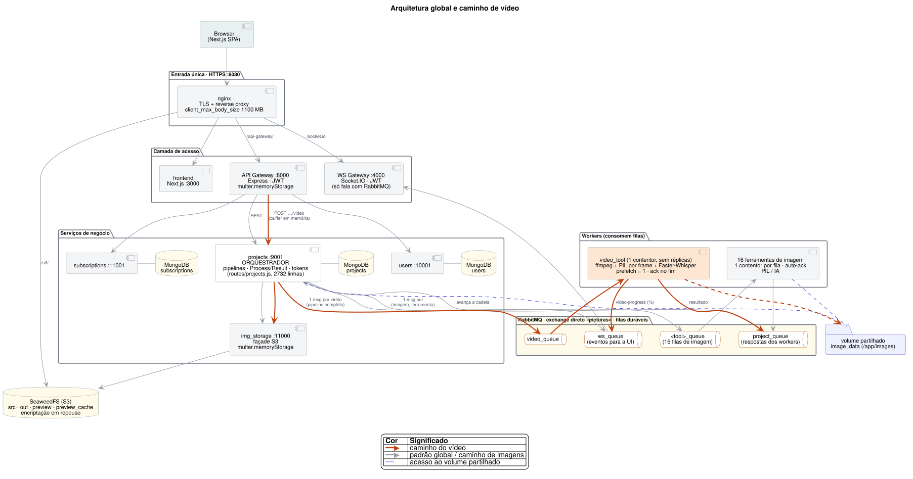
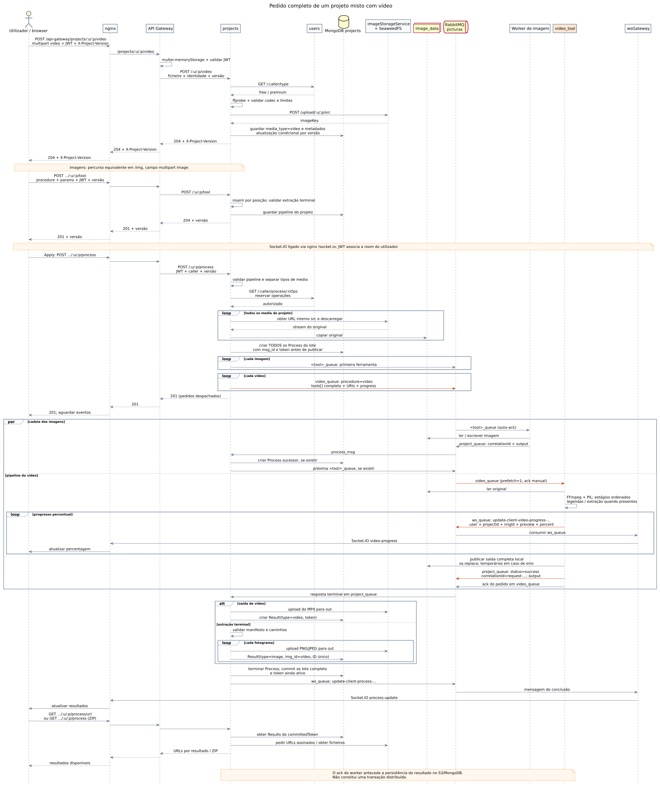

# Exercício 6 (Bloco 1) — Identificação e comparação de padrões arquiteturais

### Fase 2: Melhoria de requisitos não funcionais do PictuRAS

**Equipa:** PL2-G4\
**Elementos:**\
PG64000 — Luís Miguel Coelho\
PG65397 — Alexandre de Oliveira Monsanto\
PG63941 — Diogo Alexandre Gomes Silva\
PG63522 — José Miguel da Silva Santos\
**Commit de partida do checkout:** `484be13b4c8e96c70e7e694a2c368d5601749438` (`484be13`).\
**Base da aplicação no histórico oficial:** `052310226c51fa57a17101c7bd1ad795674aac95` (`0523102`); o commit local seguinte acrescenta documentação e infraestrutura de agentes, sem alterar a aplicação.\
**Data da análise:** 2026-11-09 (Europe/Lisbon).\
**Versão deste documento:** 1.1.\
**Versões usadas:** enunciado 1.1 e template 1.1, de 2026-11-04; diretrizes da Fase 2, versão 1, da mesma data. (EV-01–EV-05)

Este documento resolve o **Bloco 1**, tarefas 0 a 3. Analisa a extensão de vídeo no contexto da arquitetura global; não executa refactoring nem escolhe definitivamente os dois RNF da Fase 2. As avaliações arquiteturais são inferências justificadas pelos elementos identificados como `EV-nn`; previsões ainda não verificadas são identificadas como `H-nn`. Os IDs serão mantidos no Bloco 2. (EV-02, EV-05)

---

## 0. Preparação e ambiente

| **Item** | **Valor** |
|----------|-----------|
| Commit de partida | Checkout `484be13`; código da aplicação equivalente à base `0523102`, confirmado pelo histórico e pelo diff. Seis ficheiros centrais do orquestrador e worker coincidem também por SHA-256 entre checkout e contentores em execução. (EV-01, EV-28) |
| Arranque e estado observado | A solução já estava em execução. Não se repetiu a construção nem se reiniciaram serviços. `docker compose ps --format '{{.Service}} {{.State}} {{.Health}}'` mostrou 32 serviços em execução; RabbitMQ, as três bases MongoDB e `generative-mock` tinham estado `healthy`. A ausência de healthcheck nos restantes não permite concluir que estejam saudáveis apenas por estarem em execução. (EV-28) |
| Reprodução do arranque | Na raiz: `docker compose up -d --build`; acesso em `https://localhost:8080`, aceitando o certificado local. Após reconstruir o frontend, `docker compose restart nginx` se ocorrer 502. Não usar `down -v` numa instalação com dados a preservar. (EV-09, EV-33) |
| Ambiente | Ubuntu 22.04.5 LTS; kernel Linux 6.8.0-138-generic, x86_64; Intel Core i7-13700H, 14 núcleos e 20 CPU lógicos; RAM reportada de 15 GiB e swap de 2 GiB; Docker 29.9.2, build `a82e528`; Docker Compose v5.6.1. (EV-28) |
| Projeto de teste efetivamente usado | Conta gratuita e projeto dedicados ao exercício, com **1 PNG e 1 MP4** sintéticos, ambos a 160×120. Vídeo de 4 s, 10 fps, H.264 e áudio AAC de 440 Hz. Primeira execução: brilho 0,6; segunda: brilho 0,6 → extração de 3 PNG. Geradores, pedidos e verificações preservados em [preparacao.cjs](evidence/preparacao.cjs). (EV-28) |
| Resultados observados | Primeira execução: uma imagem e um vídeo MP4/H.264/AAC descarregável. Segunda: uma imagem e três fotogramas, com IDs de resultado distintos e referência ao vídeo de origem; ZIP com quatro ficheiros. A conta passou de 5 para 2 operações, coerente com custos de 1 e 2 operações de vídeo. (EV-28) |
| Amostras existentes consultadas | `samples/video/README.md`: MP4 de 10 s/720p, MOV de 6 s, MP4 de 90 s, ficheiro corrompido e WebM de fala de 177 s/1080p. O ensaio desta análise usa entradas sintéticas reproduzíveis, não alega ter executado todas essas amostras. (EV-33) |
| Problemas encontrados | A primeira consulta Docker exigiu acesso ao socket fora da sandbox. O contentor de produção do vídeo não tinha `pytest`; instalou-se apenas numa pasta temporária, sem substituir dependências da aplicação. Não se observaram falhas no percurso de API executado. O arranque de raiz não foi ensaiado nesta sessão. (EV-28) |
| Validação adicional | **8/8 testes do orquestrador** e **74/74 testes do worker** passaram. Os testes de legendagem simulam o reconhecimento, usando FFmpeg real: não medem a precisão nem o tempo do Whisper real. (EV-27, EV-28) |

O [registo de execução](evidence/validacao-2026-11-09.txt) conserva ambiente, comandos, hashes, resultados e limitações. A preparação foi feita pela API através do nginx e do gateway; não foi um ensaio interativo no browser. Não se mediram latência, débito, RAM sob carga nem frequência temporal do Socket.IO. A duração da suite de testes não é uma baseline de processamento. (EV-28)

**Como é orquestrado o processamento em lote de imagens e vídeos — 7 linhas:**

1. O *Apply* envia `POST /api-gateway/projects/:user/:project/process`, com JWT e versão do projeto, pelo nginx e API Gateway. (EV-07, EV-08)
2. `projects` valida a sequência do projeto e reserva no serviço `users` as operações necessárias no perfil de quem executa. (EV-14, EV-25)
3. Descarrega os originais do S3 para `image_data` e regista todos os `Process` do lote antes de publicar os pedidos. (EV-14)
4. Para cada imagem, envia a primeira ferramenta para `<tool>_queue`; cada resposta em `project_queue` faz o orquestrador avançar para a seguinte. (EV-15)
5. Para cada item com `media_type: "video"`, publica um pedido em `video_queue` com o pipeline completo aplicável àquele vídeo. (EV-10, EV-12, EV-14)
6. O worker processa o vídeo e emite percentagens para `ws_queue`; `wsGateway` entrega `video-progress` ao cliente através de Socket.IO. (EV-16, EV-22)
7. `projects` persiste saídas em `out`, cria `Result` e publica a conclusão; URLs/ZIP usam os resultados do `committedToken`, incluindo os fotogramas individuais quando há extração. (EV-21, EV-28)

## 1. Âmbito e vista da arquitetura

### 1.1 Fontes consultadas

| **Fonte** | **Versão / data** | **Usada para** |
|-----------|-------------------|----------------|
| [README.md](../../../README.md) | Código da base `0523102`, presente no checkout `484be13` | Arquitetura, execução, ferramentas de imagem/vídeo, regras posteriores ao MVP e testes. |
| [AGENTS.md](../../../AGENTS.md) | Mesmo checkout | Modelo de domínio, fluxos, limites e fragilidades conhecidas. |
| [doc-ext-requisitos.pdf](../../requirements/doc-ext-requisitos.pdf) | Fase 1 de 2025/2026; capa de novembro de 2025; sem versão numerada explícita; 39 páginas PDF | Requisitos originais de imagem, presets, IA e partilha; leitura direta do §6.2, pp.19–25, com 21 RNF identificados, respetivos critérios e inconsistências. |
| [doc-sol-arquitetural.pdf](../../architecture/doc-sol-arquitetural.pdf) | Fase 2 de 2025/2026; capa de janeiro de 2026; sem versão numerada explícita; 51 páginas PDF | Arquitetura herdada, táticas de qualidade, presença/versionamento, presets, cancelamento, quotas, vistas estrutural/runtime/deployment e limitações das conclusões históricas. |
| [Slides da aula 11 — Architectural Styles](../../lectures/RAS-slidesEN-11-ARCH-Styles.pdf) | JM Fernandes; outubro de 2021, conforme capa; 25 slides | Estilo idealizado versus realizado, camadas, Client–Server/N-Tier, Pipes and Filters, Batch Sequential, Publish–Subscribe e níveis de vista. Não se atribui aos slides o catálogo adicional de microserviços/Competing Consumers do HTML. |
| [doc-ext-requisitos-2627.pdf](../../requirements/doc-ext-requisitos-2627.pdf) | PL1-G4, v2.0, 2026-10-23; 85 páginas PDF | Casos de uso, catálogo de requisitos, classificação de qualidade, rastreabilidade, decisões DA-01 a DA-10 e limitações. Citações abaixo usam a **paginação impressa**, salvo indicação contrária. |
| [Diretrizes da Fase 2](../../guidelines/fase-2-guidelines-1.pdf) | Versão 1, 2026-11-04; 3 páginas | Preservação funcional, dois RNF distintos, ISO/IEC 25010:2011, baseline e avaliação reprodutível. |
| [Enunciado HTML do Bloco 1](sources/RAS-exercicio_6_bloco1_SWdesign_PT.html) | 1.1, 2026-11-04 | Âmbito, tarefas 0–3, resultados 1–3, evidências e matriz obrigatória. |
| [HTML de apoio sobre padrões](sources/RAS_support_doc_architectural_patterns_PT.html) | Sem versão/data explícita no conteúdo | Distinção entre nível global, vídeo e interior dos serviços; sete famílias de padrões; enquadramento das duas alternativas. |
| [Resolução baseada no template](resolution.md) | Estrutura original 1.1, 2026-11-04 | Organização das secções e estabilidade dos IDs. |
| [Arquitetura em SVG](diagrams/arquitetura_global_plantuml.svg) e [fonte PlantUML](diagrams/arquitetura_global.puml) | Presentes em `484be13` | Vista global existente, inspecionada visualmente e confrontada com configuração e código. |
| Código e configuração da aplicação | Checkout `484be13`; aplicação da base `0523102` | `nginx`, gateways, `projects`, `users`, `subscriptions`, armazenamento, ferramentas PIL/IA, worker de vídeo, frontend, filas, Compose, testes e configuração de backups. |
| [AUTHORS.md](../../../AUTHORS.md), [amostras](../../../samples/video/README.md) e [README do frontend](../../../frontend/README.md) | Mesmo checkout | Proveniência e condições de utilização; o README genérico do frontend não substitui o arranque integrado por nginx. |
| `memory-bank/` e `.specsmd/aidlc/` | Inicialização em 2026-11-09 | Contexto do processo: não há intents, requisitos ou decisões de implementação da Fase 2 já aprovados. |
| [ISO/IEC 25010:2011, ficha ISO](https://www.iso.org/standard/35733.html) | Edição 2011; consulta em 2026-11-09 | Confirmação da edição exigida e do modelo de oito características; classificação concreta também presente no §5.2 do PDF. |
| [Hohpe e Woolf — Pipes and Filters](https://www.enterpriseintegrationpatterns.com/patterns/messaging/PipesAndFilters.html) e [Competing Consumers](https://www.enterpriseintegrationpatterns.com/patterns/messaging/CompetingConsumers.html) | Catálogo dos autores; consulta em 2026-11-09 | Fundamentação das alternativas ALT-1 e ALT-2. |
| [RabbitMQ — Consumer Acknowledgements and Publisher Confirms](https://www.rabbitmq.com/docs/confirms) | Documentação oficial consultada em 2026-11-09 | Distinguir confirmação de consumo, confirmação de publicação e reentrega. A página atual não substitui um teste da versão implantada. |

**Enquadramento e rastreabilidade das fontes:** os três materiais anteriormente indisponíveis foram acrescentados a `docs/` e consultados diretamente nesta revisão. O documento de requisitos descreve a Fase 1 de **2025/2026**; o de solução arquitetural, a Fase 2 desse mesmo ano, documentada em janeiro de 2026. São a base anterior à extensão de vídeo do PL1-G4 e não as diretrizes da Fase 2 de **2026/2027**, que regem este exercício. A arquitetura histórica usa MinIO e `/minio/`; o checkout analisado usa SeaweedFS e `/s3/`. Por isso, os documentos fundamentam requisitos e decisões herdadas, enquanto código/configuração e EV-28 fundamentam o estado atual. (EV-04, EV-05, EV-09, EV-11, EV-34, EV-35)

O §6.2 da especificação anterior contém os RNF43–RNF66 **com lacunas de numeração**: há 21 entradas RNF; RF47 aparece intercalado, e não se inventam RNF47, RNF51 ou RNF62. Os IDs originais são mantidos. A secção 2.5 cobre agora diretamente esse catálogo, distinguindo requisitos aplicáveis ao vídeo e requisitos de imagem/assistente que apenas constituem contexto de comparação. (EV-34)

### 1.2 Vista da arquitetura global



**Ferramenta / notação:** PlantUML, vista de componentes/contentores; fonte editável em [arquitetura_global.puml](diagrams/arquitetura_global.puml). (EV-06)

| **Elemento** | **Significado** |
|--------------|-----------------|
| Setas laranja e worker de vídeo realçado | Caminho específico do vídeo, com uma mensagem por pipeline/vídeo. |
| Setas cinzentas | Relações globais e processamento de imagens. |
| Tracejado violeta | Acesso ao volume de trabalho partilhado `image_data`. |
| Cilindros e filas | Persistência em MongoDB/S3 e transporte assíncrono por RabbitMQ, respetivamente. |

A vista corresponde à combinação de microserviços, REST e mensagens, com `projects` a coordenar o processamento. Esta organização prolonga as vistas estrutural e de implantação do relatório anterior (§§7–11), que foram também inspecionadas visualmente. As bases MongoDB próprias pertencem aos três serviços de domínio; não se extrapola uma base de dados para cada ferramenta ou gateway. (EV-09, EV-10, EV-35) `users`, `projects` e `subscriptions` têm bases MongoDB próprias; `imageStorageService` é uma fachada do armazenamento S3. As ferramentas de imagem são unidades de implantação separadas, incluindo IA e o watermark fornecido como imagem externa; `expand_ai` usa `generative-mock`. (EV-08–EV-11, EV-33)

**Ressalvas à leitura da imagem:** «entrada única» descreve o percurso normal da aplicação; o Compose publica também portas de serviços internos, pelo que não é uma fronteira de segurança exclusiva. «16 filas de imagem» resume as 16 ferramentas implantadas; `definitions.json` contém adicionalmente `scale_queue`, sem serviço correspondente no Compose. O `auto-ack` foi verificado nas ferramentas que usam `Tools/utils/rabbit_mq.py`; não se inspecionou o código interno da imagem externa do watermark. A vista omite o volume `whisper_models`, o serviço de backup e o mock generativo; estes existem no Compose. As relações REST de negócio e o caminho WS/S3 completam-se no diagrama de sequência. (EV-06, EV-09, EV-15, EV-24, EV-33)

**Confronto com a arquitetura documentada em 2025/2026**

| **Aspeto herdado** | **Documento anterior** | **Situação na base analisada e implicação** |
|-------------------|------------------------|--------------------------------------------|
| Organização e conectores | Microserviços, gateway, REST para negócio, AMQP para trabalho/eventos e MongoDB por domínio (§7.1, §§8–11). | Mantêm-se; `video_tool` e `video_queue` acrescentam um caminho local ao ecossistema existente. (EV-09, EV-14, EV-16, EV-35) |
| Armazenamento | MinIO/S3, proxy `/minio/` e consola. | SeaweedFS/S3, `/s3/`, estágios e prefixos atuais; não se copiam endpoints ou instruções antigas de instalação. (EV-07, EV-11, EV-33, EV-35) |
| Exposição e segurança | As vistas apresentam nginx como ponto único de exposição e descrevem cifra de email/objetos (§2.5, §§8 e 11). | O percurso normal usa nginx, mas o Compose publica portas adicionais; os canais e a cifra de campos específicos não provam cumprimento integral de RNF44. (EV-24, EV-34, EV-35) |
| Colaboração | `project.dirty`, `X-Project-Version`, operações WS e presence/TTL (§3, §9). | São mecanismos herdados que também condicionam projetos com vídeo. O heartbeat de presença de editores é diferente do heartbeat AMQP desativado no worker de vídeo. (EV-16, EV-22, EV-35, EV-37) |
| Quota e Apply repetido | Cobrança de ferramentas IA novas, reembolso de `pendingAdvancedOps` e short-circuit quando a sequência já foi processada (§2.3, §6). | O vídeo acrescenta cobrança por efeito em cada execução; o short-circuit atual está no ramo sem operações avançadas/vídeo. A política histórica de imagem não deve ser imposta ao vídeo. (EV-14, EV-25, EV-35) |
| Cancelamento | Tokens invalidam a execução e preservam resultados anteriores (§2.1, §10); outro trecho afirma encerramento imediato (§2.10). | O código mostra invalidação lógica, não sinal de interrupção a FFmpeg/Whisper. As afirmações históricas de conclusão/robustez não substituem a análise da implementação nem medições. (EV-16, EV-25, EV-35) |

### 1.3 Diagrama de sequência de um pedido completo



Fonte editável: [sequencia_processamento.puml](diagrams/sequencia_processamento.puml). A sequência mostra o caso de sucesso de um projeto misto e as duas saídas terminais de vídeo: MP4 ou fotogramas. As setas laranja destacam as mensagens específicas de vídeo. O armazenamento agrupa a fachada e o S3 por legibilidade. (EV-08, EV-11, EV-14–EV-16, EV-21, EV-22)

| **Passo** | **Origem → Destino** | **Mensagem / endpoint / fila** | **Evidência** |
|-----------|----------------------|--------------------------------|---------------|
| Carregamento | Browser → nginx → API Gateway → `projects` | `POST /api-gateway/projects/:u/:p/video`, campo multipart `video`, JWT e `X-Project-Version`; internamente `POST /:u/:p/video`. Gateway e `projects` recebem o ficheiro em memória. | EV-07, EV-08, EV-12 |
| Validação e gravação | `projects` → `users`; `projects` → fachada S3/MongoDB | Consulta do perfil; `ffprobe`; limites; upload para `src`; gravação de `media_type`, metadados e chave S3. | EV-10–EV-12 |
| Definição do pipeline | Browser → gateway → `projects` | `POST .../:u/:p/tool`, com `procedure` e `params`; posições do pipeline persistidas no projeto; `POST .../:u/:p/reorder` para reordenar. | EV-10, EV-13 |
| *Apply* e quota | Browser → gateway → `projects` → `users` | `POST .../:u/:p/process`; consulta/reserva em `GET /:caller/process/:nOps`; nova execução identificada por token. | EV-08, EV-14, EV-25 |
| Preparação do lote | `projects` → S3 → `image_data`; `projects` → MongoDB | Downloads por stream e criação de todos os `Process` antes do primeiro despacho. O HTTP 201 confirma o despacho, não a conclusão dos efeitos. | EV-14 |
| Despacho | `projects` → RabbitMQ → workers | Imagens: `<tool>_queue`, uma etapa por pedido; vídeo: `video_queue`, pipeline completo numa mensagem. | EV-14–EV-16 |
| Progresso | `video_tool` → `ws_queue` → `wsGateway` → browser | `messageId` com prefixo `update-client-video-progress-`; campos `user`, `projectId`, `imgId`, `preview`, `percent`; evento Socket.IO `video-progress`. | EV-16, EV-22, EV-23 |
| Resposta do worker | Worker → `project_queue` → `projects` | `correlationId` coincide com o `messageId` do pedido; `output.type` distingue `video`, `image` de preview e `frames`. O worker confirma o consumo depois de publicar a resposta, antes da persistência pelo orquestrador. | EV-16, EV-21 |
| Persistência e conclusão | `projects` → S3/MongoDB → `ws_queue` → browser | Upload para `out`, `Result` por saída, verificação do token ativo e lote completo; evento `process-update`. | EV-21, EV-22 |
| Resultado | Browser → gateway → `projects`/S3 | `GET .../:u/:p/process/url` fornece URLs de resultados do token confirmado; `GET .../:u/:p/process` produz ZIP. | EV-11, EV-21, EV-28 |

Exemplo do **contrato** de um pedido de vídeo, com identificadores ilustrativos e caminhos relativos ao volume de trabalho; não é uma captura de tráfego. O campo `token` fica no registo `Process`, não neste pedido. (EV-14, EV-16)

```json
{
  "messageId": "request-example",
  "timestamp": "2026-11-09T18:00:00Z",
  "procedure": "video",
  "parameters": {
    "inputImageURI": "./images/users/U/projects/P/src/clip.mp4",
    "outputImageURI": "./images/users/U/projects/P/out/clip.mp4",
    "tools": [
      { "procedure": "brightness", "params": { "brightness": 0.6 } }
    ],
    "preview": false,
    "progress": { "user": "U", "projectId": "P", "imgId": "V" }
  }
}
```

### 1.4 Onde e porquê o sistema bifurca entre imagem e vídeo

| **Ponto de bifurcação** | **Caminho de imagens** | **Caminho de vídeo** | **Evidência** | **Porquê: facto ou hipótese** |
|-------------------------|------------------------|----------------------|---------------|------------------------------|
| Upload e modelo | `/img`, campo `image`; `media_type=image` por omissão. | `/video`, campo `video`; validação com `ffprobe` e limites por perfil; `media_type=video`. Cada endpoint recusa o outro tipo. | EV-08, EV-10, EV-12 | Facto: validação e metadados específicos antes de guardar. |
| Seleção do pipeline | `imageTools()` elimina `trim`, `speed`, `subtitles` e `extract_frames`. | `videoPipeline()` ordena os efeitos e filtra `trim`/`speed` pelo `params.imgId`; os restantes aplicam-se a todos os vídeos. | EV-12 | Facto: o domínio mantém um pipeline por projeto, com exceções temporais por vídeo, conforme RNG-05/DA-09. (EV-04) |
| Despacho e encadeamento | Um pedido por imagem/etapa; `projects` coordena as etapas seguintes. | Um pedido por vídeo, consumido pelo worker que coordena internamente as etapas. | EV-14–EV-16 | DA-01 documenta a decisão de evitar pedidos por fotograma e recomposição distribuída de áudio/vídeo. (EV-04) |
| Execução | PIL/IA em serviços separados, com ficheiros no volume. | FFmpeg, funções PIL locais e estágios de legendagem/extração no mesmo serviço. | EV-17–EV-20 | DA-06 explica a duplicação das funções PIL para não alterar os serviços de imagem no MVP. (EV-04) |
| Resposta e resultados | Resposta pode iniciar o efeito seguinte; resultados de imagem/texto. | Fonte vídeo termina a cadeia externa, mesmo quando o output é uma imagem de preview ou um manifesto `frames`. | EV-15, EV-21 | Facto: impede que fotogramas extraídos reentrem indevidamente nas ferramentas de imagem. |
| Interface | Catálogo de imagem e possibilidade de PDF. | Projetos com vídeos ocultam IA/watermark e PDF; selecionam leitor de vídeo ou imagens extraídas. | EV-23 | A restrição é facto; a dificuldade que causa ao utilizador carece de ensaio de usabilidade. (H-06) |

## 2. Identificação e análise dos padrões atuais

### 2.1 Padrão global da solução

| | |
|---|---|
| **Nome(s) do padrão / estilo** | **Microservices com API Gateway**, comunicação **REST + Event-Driven**, orquestração centralizada em `projects` e **Pipes and Filters** como composição de transformações, realizada em parte como **Batch Sequential**; organização interna parcialmente **Layered** e relações **Client–Server/N-Tier** na vista de runtime. (EV-03, EV-07–EV-10, EV-14, EV-15, EV-35, EV-36) |
| **Descrição** | O nginx encaminha os pedidos para frontend e gateways; serviços de negócio mantêm dados próprios e comunicam por REST. RabbitMQ transporta comandos de processamento, respostas e eventos, com `projects` como coordenador. Dentro dos serviços existem rotas, controladores e modelos, mas o grande módulo de rotas de `projects` também executa lógica de negócio e infraestrutura: não é uma separação estrita de camadas. (EV-08–EV-10, EV-14, EV-15) |

A classificação segue os níveis do HTML de apoio: microserviços e mensagens são globais, o pipeline tem realizações distribuída e local, e as camadas organizam o interior dos serviços. A presença de RabbitMQ não demonstra Event Sourcing, CQRS ou coreografia: nesta aplicação há um exchange direto e coordenação explícita de `projects`. Os contratos REST não demonstram a existência de um Enterprise Service Bus. (EV-03, EV-08, EV-14, EV-15, EV-33)

**Precisão da classificação segundo os slides da aula 11**

| **Conceito dos slides** | **Aplicação ao PictuRAS** | **Consequência para a análise** |
|------------------------|--------------------------|--------------------------------|
| Estilo idealizado versus realizado; níveis de vista (slides 2–6) | Microserviços é a organização dominante documentada; Client–Server/N-Tier descreve os pedidos entre interface, negócio e persistência, enquanto Layered descreve dependências internas. | Não são alternativas mutuamente exclusivas; uma pasta `controllers/` não demonstra camadas estritas, nem um módulo de rotas extenso torna todo o sistema uma Big Ball of Mud. (EV-03, EV-10, EV-35, EV-36) |
| Pipes and Filters versus Batch Sequential (slides 10–13) | Os workers de imagem concluem o ficheiro antes de `projects` despachar o efeito seguinte; entre estes efeitos há comportamento **Batch Sequential**. No vídeo ordinário, FFmpeg→PIL→FFmpeg trata frames incrementalmente; entre estágios de legendagem e edição materializam-se vídeos completos. | Mantém-se a classificação de pipeline do HTML, acrescentando a distinção de execução. A ausência de concorrência entre etapas dependentes de um ficheiro não impede paralelismo entre media diferentes. (EV-15, EV-17, EV-19, EV-36) |
| Publish–Subscribe (slides 16–17) | Eventos alimentam a UI, mas os pedidos de trabalho usam filas diretas: `video_queue` tem entrega a um consumidor por pedido. | Event-Driven não significa que cada worker receba uma cópia de cada vídeo. ALT-2 usa consumidores concorrentes, não broadcast. (EV-16, EV-22, EV-31, EV-33, EV-36) |
| Model-Centered, Peer-to-Peer, Map-Reduce e Farm (slides 14–15, 22–24) | A aplicação tem bases por domínio e coordenação explícita; não é um único modelo partilhado, uma rede de pares, nem reparte/reduz os frames entre nós. ALT-2 forma um pool de workers na implantação. | A existência de MongoDB, filas ou réplicas não basta para atribuir os restantes estilos à solução. (EV-09, EV-10, EV-14, EV-16, EV-36) |

No domínio de negócio, `users` concentra contas, perfis e quota, enquanto `subscriptions` trata planos e pagamentos simulados, não subscrições de eventos. Essa separação e as bases próprias exemplificam o padrão global fora do processamento de media. O nome da rede `elk` também não demonstra observabilidade centralizada: os serviços ELK estão comentados no Compose. (EV-09, EV-10, EV-25, EV-33)

**Decisões globais que condicionam o vídeo**

| **Decisão global** | **Evidência** | **Efeito no vídeo** |
|--------------------|---------------|---------------------|
| Entrada normal por nginx, JWT no gateway | EV-07, EV-08 | O vídeo reutiliza autenticação e encaminhamento; o corpo pode atingir 1100 MiB no nginx e é integralmente recebido nos serviços com `memoryStorage`. |
| Dados de negócio separados por serviço | EV-09, EV-10 | Perfil/quota exigem chamada a `users`; projeto/execução/resultado pertencem a `projects`. Não existe uma transação única entre quota, broker, S3 e MongoDB. |
| Mensagens com IDs de correlação | EV-14, EV-16, EV-33 | Pipeline não ocupa um pedido HTTP durante toda a edição; respostas devem ser correlacionadas com um `Process` existente. |
| Pipeline e processamento em lote por projeto | EV-10, EV-12, EV-14 | Vídeos e imagens partilham efeitos comuns; só `trim` e `speed` são selecionados por vídeo. Alterar este modelo seria mudança funcional. |
| S3 persistente e volume de trabalho partilhado | EV-09, EV-11, EV-14 | Originais/resultados vivem em S3; workers recebem caminhos no `image_data`. Replicar entre hosts exigiria disponibilizar esses ficheiros sem presumir que um volume local é distribuído. |
| Compose numa rede bridge, sem política de autoscaling | EV-09 | O vídeo é um serviço com uma instância por omissão; escalar implica também capacidade física e tratamento da concorrência. |
| Progresso encaminhado por `wsGateway` | EV-22, EV-23 | O vídeo herda a entrega de eventos, mas o cliente mantém o acompanhamento em memória e não recebe histórico após refresh. |

**Benefícios e desafios do padrão global**

| **Tipo** | **Descrição** | **Característica / subcaracterística ISO/IEC 25010:2011** | **Facto / hipótese** |
|----------|---------------|----------------------------------------------------------|----------------------|
| Benefício | Serviços e ferramentas com implantação separada permitem alterar uma ferramenta sem reconstruir todos os serviços; a independência real é limitada pelos contratos e volume comuns. | Manutenibilidade — modularidade/modificabilidade | EV-09, EV-15, EV-33; inferência estrutural. |
| Benefício | Pedidos de processamento usam filas e conclusão assíncrona, evitando manter a ligação HTTP durante toda a transformação. | Eficiência de desempenho — utilização de recursos; usabilidade — operabilidade | EV-14, EV-22; não implica que a interface esteja livre. |
| Benefício | Separação `src`/`out`, persistência de projetos e resultados por execução favorecem preservar o original e apresentar resultados identificáveis. | Fiabilidade — recuperabilidade; adequação funcional — correção funcional | EV-10, EV-11, EV-21, EV-28. |
| Desafio | `projects` concentra validação, quotas, encadeamento, S3, cache, partilha e tokens num ficheiro de rotas com 2732 linhas. O número de linhas evidencia concentração, não mede por si só manutenibilidade. | Manutenibilidade — modularidade/analisabilidade | EV-10, EV-14, EV-15; esforço de alteração a avaliar em H-04. |
| Desafio | Ferramentas Python de imagem usam `auto_ack=True`; a correlação dos erros é inconsistente. O consumidor de respostas de `projects` confirma a mensagem sem aguardar a conclusão do callback assíncrono. | Fiabilidade — tolerância a falhas/recuperabilidade | EV-15, EV-30; risco de perda a reproduzir em H-03. |
| Desafio | Receção integral de uploads em três serviços e composição de ZIP em memória podem pressionar a RAM com ficheiros grandes. | Eficiência de desempenho — utilização de recursos/capacidade | EV-08, EV-11, EV-12, EV-21; dimensão do impacto por medir em H-05. |
| Desafio | Há portas internas publicadas, confiança em headers internos e validação TLS desativada; a proteção do gateway não cobre todos os percursos possíveis. | Segurança — confidencialidade/integridade/autenticidade | EV-24; extensão explorável a verificar em H-07. |

### 2.2 Padrão do processamento de vídeo

| | |
|---|---|
| **Nome do padrão** | **Work Queue com consumidor único por implantação e pipeline monolítico local**, um *Pipeline Monolith* dentro dos microserviços. O caminho ordinário processa frames incrementalmente; as fronteiras que materializam ficheiros completos entre estágios são **Batch Sequential**. Tem módulos internos, mas uma só unidade de implantação. (EV-03, EV-09, EV-16–EV-20, EV-36) |
| **Descrição** | `video_queue` entrega um vídeo e a sua sequência ao `video_tool`; `prefetch_count=1` e execução bloqueante limitam cada instância a um trabalho de cada vez. O worker lê ficheiros partilhados, processa estágios ordenados, publica progresso/resposta e só depois confirma o consumo. O Compose não configura réplicas nem autoscaling. (EV-09, EV-16) |
| **Contraste com imagens** | Nas imagens, a sequência atravessa serviços por ferramenta e volta a `projects` entre etapas; no vídeo, a sequência é executada no interior do worker, sem mensagens por efeito/fotograma. Isto não torna toda a aplicação monolítica. (EV-14–EV-20) |

**Benefícios e desafios do padrão do vídeo**

| **Tipo** | **Descrição** | **Característica / subcaracterística ISO/IEC 25010:2011** | **Facto / hipótese** |
|----------|---------------|----------------------------------------------------------|----------------------|
| Benefício | No caminho ordinário, uma passagem de descodificação alimenta todos os efeitos PIL e uma codificação produz o MP4; não há intermediários de vídeo por efeito comum. | Eficiência de desempenho — comportamento temporal/utilização de recursos | EV-17, EV-18; vantagem temporal face a ALT-1 ainda em H-01. |
| Benefício | `trim` limita a janela lida; `speed` reescala os tempos e ajusta o áudio com `atempo`; entrada e saída ficam separadas. | Eficiência de desempenho — utilização de recursos; adequação funcional — correção funcional | EV-17, EV-27. |
| Benefício | Escrita temporária e `os.replace` só publicam a saída local completa em execuções normais; exceções tratadas limpam temporários e preservam o original. | Fiabilidade — tolerância a falhas | EV-17, EV-19, EV-20, EV-27. Não é garantia contra SIGKILL nem transação S3/MongoDB. |
| Benefício | Ack manual permite reentrega de pedido não confirmado quando a ligação/worker cai; é mais apropriado para trabalhos demorados do que auto-ack. | Fiabilidade — recuperabilidade | EV-16, EV-30; recuperação de ponta a ponta por validar em H-03. |
| Benefício | FFmpeg e dependências estão no contentor; modelo Whisper persistente e carregado de forma preguiçosa por processo. | Portabilidade — instalabilidade; eficiência de desempenho — utilização de recursos | EV-09, EV-19, EV-33. |
| Desafio | Um vídeo ou uma transcrição ocupa o único consumidor; novos vídeos e previews partilham a mesma fila. A espera sob carga é hipótese de impacto, embora a serialização por instância seja verificável. | Eficiência de desempenho — capacidade/comportamento temporal | EV-09, EV-16, EV-19; H-02 e H-08. |
| Desafio | Efeitos comuns, legendagem e extração partilham dependências, processo e implantação; `effects.py` duplica operações PIL dos serviços de imagem. | Manutenibilidade — modularidade/modificabilidade | EV-18–EV-20; impacto no esforço em H-04. |
| Desafio | Legendagem introduz novas codificações; extração usa seeks por amostra e pode renderizar antes a timeline completa. A afirmação «decode/encode uma vez» não vale para qualquer pipeline. | Eficiência de desempenho — comportamento temporal/utilização de recursos | EV-17, EV-19, EV-20; custos por medir em H-08. |
| Desafio | Erros tratados também terminam com ack, sem retentativa automática; `heartbeat=0`; publicação sem confirmações nem marca de persistência explícita; callback de respostas não aguardado pelo consumidor Node. | Fiabilidade — tolerância a falhas/recuperabilidade | EV-15, EV-16, EV-30; H-03. |
| Desafio | Cancelar invalida a execução em `projects`, mas não interrompe o FFmpeg/Whisper; só há reembolso de operações avançadas de imagem. | Usabilidade — operabilidade; eficiência de desempenho — utilização de recursos | EV-25. |

### 2.3 Relação entre o padrão global e o padrão do vídeo

| **Aspeto** | **O que a organização global estabelece** | **O que o vídeo faz** | **Segue / afasta-se** | **Consequência** | **Evidência** |
|------------|------------------------------------------|-----------------------|-----------------------|------------------|---------------|
| Entrada e domínio | Gateways e pipeline por projeto | Reutiliza os mesmos projetos, identidade, versão e quota | Segue | Preserva o processamento em lote e o modelo de partilha/presets. | EV-08, EV-10, EV-12, EV-25 |
| Transporte de trabalhos | Filas e IDs de correlação | Acrescenta `video_queue`; responde em `project_queue` | Segue | Integração no mecanismo assíncrono existente. | EV-14, EV-16, EV-33 |
| Granularidade dos filtros | Nas imagens, um serviço por ferramenta | Todos os efeitos de vídeo no mesmo serviço | Afasta-se do caminho de imagens | Menos comunicação por etapa; menor isolamento de implantação entre efeitos de vídeo. | EV-15, EV-17–EV-20 |
| Orquestração | `projects` coordena cada etapa de imagem | `projects` coordena o lote; worker coordena os estágios do vídeo | Segue no lote; afasta-se nas etapas | A lógica de progressão está dividida entre dois níveis; novos tipos de saída exigem cuidados em ambos. | EV-14, EV-15, EV-17, EV-21 |
| Ficheiros | S3 persistente + volume de trabalho | Lê/escreve caminhos em `image_data` | Segue | Replicação no mesmo host reutiliza o volume; múltiplos hosts exigem outra garantia de acesso. | EV-09, EV-11, EV-14 |
| Fiabilidade de consumo | Imagens com auto-ack nos helpers comuns | Vídeo com ack manual e prefetch 1 | Afasta-se, com intenção de maior recuperabilidade | Reentrega torna-se possível, mas duplicação, persistência de mensagens e confirmação final ainda exigem análise. | EV-15, EV-16, EV-30 |
| Progresso | Eventos de conclusão/etapa para WS | Acrescenta percentagem por vídeo | Segue e estende | Mantém o gateway; o estado visual continua dependente da sessão do browser. | EV-22, EV-23 |

O vídeo herda autenticação no acesso normal, quotas, projetos persistentes, armazenamento e distribuição de eventos. (EV-08–EV-11, EV-22, EV-25)\
O domínio impõe efeitos comuns por projeto e compatibilidade com imagens; o volume partilhado restringe a liberdade de distribuição física. (EV-09, EV-12)\
O desvio na granularidade evita uma troca de mensagens e ficheiros por efeito, mas reúne tarefas heterogéneas no mesmo consumidor. (EV-16–EV-20)\
Daqui resultam oportunidades de melhoria de capacidade e modularidade; os ganhos quantitativos de uma alternativa permanecem hipóteses, não propriedades automáticas de um padrão. (H-01, H-02, H-04)

### 2.4 Legendagem automática e extração de fotogramas

| **Funcionalidade** | **Como se integra no padrão do vídeo** | **Impacto nos atributos de qualidade** | **Evidência** |
|--------------------|----------------------------------------|-----------------------------------------|---------------|
| Legendagem automática | `subtitles` é um estágio local, aplicado a todos os vídeos. O worker agrupa efeitos ordinários contíguos, alterna-os com `caption_video` e preserva a ordem: efeitos posteriores atuam também sobre o texto já gravado. Faster-Whisper `small`, CPU/int8, deteta o idioma e transcreve, sem tradução. Sem áudio/fala, o estágio de legendagem é um no-op; a normalização inicial para MP4 pode ainda ocorrer. | Não envia áudio a uma API de reconhecimento, mas partilha CPU/processo com todos os vídeos. A cache em `whisper_models` evita repetir downloads; cada réplica tem o seu modelo em RAM. Renderizar legendas implica nova codificação. Preview com alterações temporais posteriores pode exigir estágios anteriores completos. Correção da transcrição e atrasos reais estão por medir, não são demonstrados pelos testes simulados. (H-08, H-09) | EV-09, EV-17, EV-19, EV-27, EV-33 |
| Extração de fotogramas | `extract_frames` é único, terminal e aplicado a todos os vídeos. Sem efeitos anteriores, faz seek no original; com efeitos, primeiro obtém o vídeo editado completo. Devolve manifesto de 1–100 PNG/JPEG; por intervalo, excesso de 100 é recusado. Preview é uma folha de até seis amostras distribuídas pela timeline editada completa. | O limite restringe saídas e o diretório temporário evita publicar um conjunto local incompleto em erros tratados. Muda a cardinalidade/tipo do resultado: `projects` valida caminhos, conserva `img_id` de origem e cria IDs/nomes distintos. Faz rollback de persistência em falha, de melhor esforço; mantém barreiras `Process` nas execuções com extração. Não garante transação distribuída nem preview sempre rápido. (H-03, H-08) | EV-12, EV-14, EV-20, EV-21, EV-27, EV-28 |

«Legendagem depois de trim/speed» é uma recomendação de eficiência e posicionamento do texto; não é uma ordem obrigatória universal validada pelo servidor. «Extração sempre no fim e no máximo uma vez» é uma regra obrigatória validada ao inserir, reordenar e executar. A diferença deve ser preservada em qualquer refactoring. (EV-12, EV-13, EV-17, EV-33)

### 2.5 Suporte aos requisitos não funcionais existentes e regras sem requisito explícito

A classificação usa a **ISO/IEC 25010:2011**, como exigido pelas diretrizes. «Elasticidade» é aqui uma tática/objetivo ligado a **capacidade** e **utilização de recursos**, não uma subcaracterística autónoma da edição 2011. As células avaliam o suporte observado; «Parcial» não certifica um critério quantitativo. Os atributos entre parênteses nos RNF herdados são a classificação desta análise, não novos nomes/IDs da especificação. O PDF do PL1-G4 distingue metas de produção e critérios MVP; os critérios dos documentos anteriores são também transcritos com a sua origem. **Nenhum desses números é um novo alvo aprovado por PL2-G4.** (EV-04, EV-05, EV-32, EV-34)

**RNF da base de 2025/2026 — leitura direta do §6.2, pp.19–25**

«Não aplicável diretamente» delimita o âmbito do requisito original (por exemplo, assistente de imagem); não significa falha do worker de vídeo. Estes requisitos entram como contexto e condicionantes de preservação funcional, sem acrescentar assistente de vídeo, armazenamento local novo ou outras funcionalidades. (EV-02, EV-05, EV-34)

| **Requisito / critério original e atributo ISO/IEC 25010:2011** | **Padrão global suporta?** | **Padrão do vídeo suporta?** | **Porquê** | **Evidência** |
|--------------------------------------------------------------|----------------------------|------------------------------|------------|---------------|
| **RNF43 — Performance e tempo de resposta:** filtros comuns <5 s, IA <1 min; 90% das operações no limite (eficiência de desempenho — comportamento temporal). | Parcial | Parcial, com requisito específico | As filas e cache/short-circuit reduzem trabalho desnecessário, mas não há medição de percentil local. Para vídeo, `REQ-VID-EDIT-010` substitui o limite fixo por tempo proporcional à duração; a medição histórica do PL1-G4 não é a baseline desta equipa. | EV-04, EV-14, EV-17, EV-26, EV-34, EV-35; H-01, H-13 |
| **RNF44 — Segurança e privacidade:** fotos, projetos e presets cifrados em trânsito (TLS 1.2+) e repouso; acesso autenticado e revogação (segurança — confidencialidade/integridade/autenticidade). | Parcial | Parcial, herdado | JWT, TLS externo, cifra de email/objetos e autorização no percurso normal são mecanismos concretos, não prova de cifra de todos os metadados, confiança interna ou RGPD integral. Portas internas/fachada e partilhas públicas de presets também impedem afirmar literalmente «nenhum ficheiro ou link sem autenticação». | EV-08, EV-11, EV-24, EV-34, EV-35, EV-37; H-07 |
| **RNF45 — Armazenamento flexível local/cloud:** escolha pelo utilizador e acesso noutro dispositivo em ≤5 s (portabilidade — adaptabilidade; eficiência de desempenho — comportamento temporal). | Parcial | Parcial, herdado | Há persistência central em MongoDB/S3 e transferência de ficheiros, mas não se demonstrou um modo de projeto local sincronizado à escolha do utilizador nem acesso entre dispositivos em ≤5 s. Exportar um ZIP não equivale a esse modo. SeaweedFS substitui MinIO; preservar originais é uma regra distinta. | EV-09–EV-11, EV-21, EV-33–EV-35; H-13 |
| **RNF46 — Verificação de alterações antes da partilha:** aviso/bloqueio até guardar (usabilidade — proteção contra erro do utilizador; segurança — integridade). | Sim, no desenho | Sim, herdado pelo projeto | A UI verifica `hasUnsavedChanges` e a criação de link recusa `project.dirty`; os pedidos são condicionados por versão. Não se confunde esta regra com RNF53 nem com confirmação de processamento. | EV-10, EV-34, EV-35, EV-37 |
| **RNF48 — Exibir limite diário de operações:** saldo sempre visível e atualizado após processamento (usabilidade — operabilidade). | Parcial | Parcial, no cliente comum | Há contador para free/anónimo e atualização da sessão; EV-28 confirmou saldo 5→2 pela API, não visibilidade permanente no browser. A contagem por efeito/vídeo e os reembolsos pertencem aos requisitos QUOTA, tratados abaixo. | EV-25, EV-28, EV-34, EV-35, EV-37; H-06 |
| **RNF49 — Segurança do link:** comprimento >32 caracteres e componente aleatória hash/UUID (segurança — confidencialidade). | Sim, no formato | Sim, na partilha do projeto | A criação usa UUID v4, com representação de 36 caracteres. Isto satisfaz a estrutura exigida, sem provar autorização completa ou resistência de todos os percursos de acesso; não é o mesmo contrato que o URL S3 temporário. | EV-34, EV-35, EV-37; H-07 |
| **RNF50 — Desempenho da geração do link:** <1000 ms em 99% dos casos (eficiência de desempenho — comportamento temporal). | Parcial | Parcial, herdado | Geração de UUID e persistência são locais ao serviço, mas há chamadas a perfil/presença e rede no percurso. Não se mediu o percentil 99. | EV-34, EV-35, EV-37; H-13 |
| **RNF52 — Persistência da partilha:** permissões/link mantidos entre sessões até revogação (fiabilidade — recuperabilidade; segurança — integridade). | Sim, no desenho | Sim, herdado | `sharedLinks` pertence ao projeto persistido; revogação atualiza a base e resolução recusa links revogados. Isto não implica invalidar imediatamente um URL S3 já emitido e ainda válido. | EV-10, EV-11, EV-34, EV-35, EV-37 |
| **RNF53 — Gestão de concorrência:** estratégia definida e testada para edição simultânea (segurança — integridade; fiabilidade — tolerância a falhas). | Parcial | Parcial, herdado | Versão esperada, atualização condicional, HTTP 409 e operações WS implementam a estratégia otimista. Coedição de ferramentas não prova isolamento de dois Apply nem dos caminhos de ficheiros do vídeo. | EV-10, EV-22, EV-34, EV-35, EV-37; H-12, H-13 |
| **RNF54 — Tempo de resposta do assistente IA:** descrição <10 s; fit criterion 95% <3000 ms (eficiência de desempenho — comportamento temporal). | Parcial; critério contraditório | Não aplicável diretamente | O assistente usa heurísticas/features e previews em `projects`, não Whisper. Os dois limiares não são equivalentes: deve clarificar-se o critério antes de afirmar conformidade. Nenhum se transfere automaticamente para a legendagem. | EV-34, EV-35, EV-37; H-13 |
| **RNF55 — Clareza das sugestões:** 90% dos utilizadores reconhecem o efeito pelo nome/preview (usabilidade — reconhecimento da adequação/operabilidade). | Parcial | Não aplicável diretamente | Nomes, descrições e previews existem; não houve ensaio com utilizadores. É referência de usabilidade do assistente de imagem, não um requisito de correção das legendas. | EV-34, EV-35, EV-37; H-06 |
| **RNF56 — Disponibilidade do serviço de IA:** uptime mensal ≥99%, com exclusão de manutenção planeada (fiabilidade — disponibilidade). | Parcial | Não aplicável diretamente | A implantação inclui reinícios e serviços separados, mas não se recolheu uptime mensal nem se demonstrou alta disponibilidade. Disponibilidade do assistente de imagem e do worker de legendas requer cenários próprios. | EV-09, EV-33–EV-35; H-13 |
| **RNF57 — Privacidade do assistente:** imagens/instruções apenas em memória temporária, sem persistência após processamento (segurança — confidencialidade). | Parcial | Não aplicável diretamente | O pedido usa buffers, mas o assistente grava previews derivados no estágio S3 `preview`; expirar o URL não apaga o objeto. É necessário distinguir o original do projeto das cópias/previews do assistente e verificar retenção/limpeza. Reconhecimento local do vídeo não demonstra este requisito do assistente. | EV-11, EV-34, EV-35, EV-37; H-07, H-13 |
| **RNF58 — Escalabilidade do assistente IA:** 100 pedidos concorrentes com média <15 s (eficiência de desempenho — capacidade/comportamento temporal). | Parcial | Não aplicável diretamente | Não há ensaio com 100 pedidos nem escala automática configurada. O assistente gera previews em `projects`; replicar `video_tool` não acelera esse endpoint. | EV-09, EV-34, EV-35, EV-37; H-13 |
| **RNF59 — Modo escuro:** alternância nas definições (usabilidade — operabilidade/estética da interface). | Sim, no desenho | Sim, na interface comum | `ThemeProvider` aplica o tema e persiste a escolha; é um mecanismo do frontend reutilizado pelos projetos com vídeo, independente do padrão dos workers. | EV-34, EV-35, EV-37 |
| **RNF60 — Aplicação de preset:** descrição <2 s; critério ≤2 s em 95% dos casos (eficiência de desempenho — comportamento temporal). | Parcial | Parcial, na configuração do pipeline | O frontend atualiza otimisticamente as ferramentas e persiste por reorder. Essa resposta visual não mede a confirmação do servidor nem a renderização dos media. O limiar não pode ser usado como prazo para transcodificar um vídeo. | EV-12, EV-13, EV-34, EV-35, EV-37; H-13 |
| **RNF61 — Reverter/Reset sem perda:** hash da imagem reposta igual ao original (adequação funcional — correção funcional; segurança — integridade). | Parcial | Parcial, por preservação do original | `src` é separado e o Reset limpa ferramentas/saídas; a suite verifica preservação do original de vídeo. Não se fez o ensaio integral de Reset por hash nesta revisão. Um MP4 recodificado não tem de ser binariamente igual à fonte para cumprir a edição. | EV-11, EV-17, EV-27, EV-34, EV-35, EV-37; H-13 |
| **RNF63 — Presets persistentes:** sobrevivem ao reinício (fiabilidade — recuperabilidade). | Sim, no desenho | Sim, como serviço comum | Presets associados ao utilizador ficam no MongoDB de `users`, num volume persistente. A continuidade do preset não garante que todos os seus efeitos sejam válidos para vídeo; a validação da sequência continua necessária. | EV-09, EV-12, EV-34, EV-35, EV-37 |
| **RNF64 — Consistência de presets:** nenhum duplicado/perdido após 100 ciclos (segurança — integridade; fiabilidade — maturidade). | Parcial | Parcial, como serviço comum | Há esquema, índice único por utilizador/nome e tratamento de conflito; não se executaram os 100 ciclos nem falhas concorrentes. O worker de vídeo não controla esta persistência. | EV-34, EV-35, EV-37; H-13 |
| **RNF65 — Limite de colaboração:** máximo de dois utilizadores em projeto de dono não premium; premium sem essa restrição (eficiência de desempenho — capacidade). | Parcial | Parcial, herdado | Presença/TTL e limite 2 são verificados pelo serviço de projetos; operações com vídeo também passam no middleware. Contar presenças antes de inserir não prova limite sob admissões simultâneas. Limitar editores não equivale a processar dois vídeos em paralelo. | EV-09, EV-34, EV-35, EV-37; H-02, H-13 |
| **RNF66 — Disponibilidade da criação de preset:** opção ativa apenas com ≥2 ferramentas (usabilidade — proteção contra erro do utilizador). | Sim, no desenho | Sim, no editor comum | A UI e as rotas de criação/alteração validam o mínimo de duas ferramentas. Apesar do nome «disponibilidade», trata-se de uma condição de operação/validade e não de uptime do serviço. | EV-34, EV-35, EV-37 |

As colunas distinguem apoio estrutural de critério demonstrado: «Sim, no desenho» identifica mecanismos encontrados; as metas de tempo, percentis, carga, ciclos, acesso e concorrência exigem ensaios próprios (H-13). A alocação histórica (§7.3 da arquitetura anterior) liga estes RNF a frontend, gateway, `users` e `projects`, mas os rótulos usados nesse relatório — como «persistência», «integridade» ou «robustez» — não são tratados aqui como características autónomas da ISO/IEC 25010:2011. (EV-32, EV-34, EV-35)

**Requisitos da extensão de vídeo e regras posteriores ao PDF do PL1-G4**

| **Requisito / regra** | **Padrão global suporta?** | **Padrão do vídeo suporta?** | **Porquê** | **Evidência** |
|-----------------------|----------------------------|------------------------------|------------|---------------|
| `REQ-VID-ACCESS-001` — acesso restrito ao projeto | Parcial | Parcial | JWT/partilha no percurso normal; o worker depende da confiança interna e o acesso direto a serviços limita a garantia de isolamento. Não se demonstrou conformidade integral por todos os percursos. | EV-04, EV-08, EV-11, EV-24; H-07 |
| `REQ-VID-STORE-001/002/003`, `EDIT-003` — limite total, limpeza e preservação dos originais | Parcial | Parcial | `src`/`out` e resultados separados existem; limite de armazenamento por perfil não está implementado e cópias locais podem permanecer até nova execução. Não se confunde esta regra de vídeo com a escolha/sincronização local/cloud do RNF45. | EV-04, EV-10, EV-11, EV-14, EV-17, EV-34 |
| `REQ-VID-QUOTA-001/002/003` e `CANCEL-002` — operações e reposição | Parcial | Parcial | Reserva por efeito/vídeo e bloqueio por quota existem; não há reposição das operações de vídeo em falha/cancelamento. EV-28 confirmou saldo 5→2 nas duas execuções; RNF48 é o requisito distinto de apresentação do saldo. | EV-04, EV-12, EV-25, EV-28, EV-34 |
| `REQ-VID-EDIT-009` — resultados reproduzíveis | Parcial | Sim, no âmbito testado | O desenho global não impõe determinismo; a suite verifica fotogramas iguais para a mesma edição ordinária. Não prova determinismo do Whisper real nem igualdade binária dos ficheiros MP4. | EV-04, EV-17, EV-27 |
| `REQ-VID-SUBMIT-008` — aceitação pós-envio: MVP <3 s; alvo <1 s | Parcial | Parcial | Upload/validação síncronos incluem buffers, ficheiro temporário, ffprobe e S3. Não se mediu a aceitação com ficheiros de 10/500 MB. | EV-04, EV-08, EV-11, EV-12; H-05 |
| `REQ-VID-EDIT-010` — edição simples: MVP ≤5× duração; alvo ≤1× | Parcial | Parcial | Há fundamento estrutural para reduzir trabalho redundante, mas faltam medições locais de latência, incluindo espera quando aplicável. | EV-04, EV-17; H-01, H-08 |
| `REQ-VID-PREVIEW-005` — preview muito mais rápido que edição | Parcial | Parcial | Cache e limite de 3 s no caminho ordinário; transcrição/efeitos posteriores e extração podem exigir timeline completa. O requisito «poucos segundos» precisa de operacionalização no Bloco 2. | EV-04, EV-17, EV-20, EV-26; H-08 |
| `REQ-VID-EDIT-011` — capacidade: MVP ≥2 vídeos em paralelo quando há recursos | Parcial | Não na implantação por omissão | O broker aceita vários pedidos, mas um único worker com prefetch 1 executa-os sequencialmente. Réplicas são possíveis como alternativa, não configuradas nem ensaiadas nesta análise. | EV-04, EV-09, EV-16; H-02 |
| `REQ-VID-SUBMIT-009` — interoperabilidade de formatos | Parcial | Sim, no âmbito testado | Validação aceita MP4/MOV/WebM e codecs definidos; a saída de edição ordinária é MP4/H.264/AAC, verificada em testes e no ensaio. Extração tem legitimamente saída de imagens, acrescentada depois do PDF. | EV-04, EV-12, EV-17, EV-20, EV-27, EV-28 |
| `REQ-VID-STATUS-003` — progresso: MVP intervalo ≤5 s; alvo ≤2 s | Parcial | Parcial | Progresso é condicionado pelo avanço percentual, não por temporizador. «A cada 2%» não prova intervalo de 5 s em transcrição, fila ou frames lentos. | EV-04, EV-16, EV-17, EV-19, EV-22; H-10 |
| `REQ-VID-FAIL-003` — mensagens compreensíveis e diferenciadas | Parcial | Parcial | Existem motivos para limites, trim, velocidade e codecs; erros inesperados podem continuar genéricos e os erros das ferramentas comuns de imagem têm problemas de contrato. Não houve avaliação com utilizadores. | EV-04, EV-12, EV-15, EV-16, EV-23; H-06 |
| `REQ-VID-FAIL-004` — tolerância a falhas e recuperação | Parcial | Parcial | Ack manual protege o pedido de vídeo não confirmado; não garante entrega persistente da resposta, espera pelo commit ou retentativa de erro tratado. Não se injetaram falhas de processo/broker. | EV-04, EV-15, EV-16, EV-21, EV-30; H-03 |
| `REQ-VID-EDIT-012` — taxa de sucesso: MVP ≥95%; alvo ≥99,5% | Parcial | Parcial | Testes aprovados verificam cenários delimitados; não constituem amostra operacional para calcular a taxa exigida. | EV-04, EV-27, EV-28; H-11 |
| `REQ-VID-ACCESS-002` — endereços temporários e não adivinháveis | Parcial | Parcial | Ficheiros recebem UUID e URLs assinados com validade de uma hora. Não foram ensaiados expiração/rotação; exposição da fachada é uma limitação transversal. | EV-04, EV-11, EV-24; H-07 |
| `REQ-VID-ACCESS-003` — biblioteca privada | Não | Não | A biblioteca está especificada no PDF mas não existe na base. Implementá-la seria nova funcionalidade, fora do refactoring desta fase. | EV-04, EV-05, EV-10 |
| `REQ-VID-EDIT-013` — acrescentar efeito sem alterar os existentes | Parcial | Parcial | `FRAME_EFFECTS` facilita registar funções independentes, mas listas no orquestrador, frontend e implantação têm de permanecer coerentes; vídeo exige reconstruir o mesmo serviço. Não foi feito um ensaio de esforço de modificação. | EV-04, EV-12, EV-18, EV-23; H-04 |
| `REQ-VID-EDIT-014` — componentes isolados/instalabilidade | Sim, no desenho | Sim, nos contentores observados | FFmpeg e dependências de vídeo estão nos Dockerfiles, sem instalação no host para utilização da aplicação. Não se repetiu instalação de raiz; imagens `latest`/dependências sem fixação completa limitam reprodução futura. | EV-04, EV-09, EV-28, EV-33 |
| `REQ-VID-EDIT-002`, `CANCEL-001/002`, `TIMEOUT-001` — regras de trabalhos demorados | Parcial | Parcial | Backend assíncrono, mas overlay bloqueia a interface; refresh perde acompanhamento; cancelar invalida resultados e não interrompe o worker. Há timeouts em subprocessos de legendas/extração, mas não um prazo global configurável de trabalho. | EV-04, EV-17, EV-19, EV-20, EV-23, EV-25 |
| RNG-05 e `REQ-VID-EDIT-001/005`, `TRIM-003`, `SPEED-003` | Sim | Sim | Pipeline por projeto; filtros comuns abrangem media; efeitos temporais selecionados pelo vídeo. Imagens ignoram ferramentas exclusivamente de vídeo. | EV-04, EV-10, EV-12, EV-27 |
| **Sem requisito explícito no PDF:** `subtitles` por projeto, idioma detetado, sem fala como no-op | Sim | Sim, no âmbito testado | Integra-se como estágio ordenado; testes usam reconhecimento simulado. Colocação depois dos efeitos é recomendação, não restrição de validade. | EV-17, EV-19, EV-27, EV-33 |
| **Sem requisito explícito no PDF:** extração única, terminal e sem `imgId` | Sim | Sim | Validada no servidor e worker; novas ferramentas entram antes da extração e reordenações inválidas são recusadas. | EV-12, EV-13, EV-17, EV-27 |
| **Sem requisito explícito no PDF:** 1–100 imagens, PNG/JPEG e preview de até seis amostras | Sim | Sim, no âmbito testado | Manifesto completo, nomes/IDs únicos e `img_id` de origem; preview usa a timeline editada completa. A regra dos 3 s não se generaliza à extração. | EV-20, EV-21, EV-27, EV-28 |
| **Invariante técnica sem requisito explícito:** registar o lote antes de despachar e confirmar somente a execução ativa | Sim | Sim, com limites | Evita commit antecipado de lote incompleto e commit tardio após cancelamento; não elimina todas as falhas distribuídas nem concorrência entre dois Apply no mesmo projeto. | EV-14, EV-21, EV-27; H-03, H-12 |

O PDF do PL1-G4 não é prova automática do estado atual: o §7.3 e o teste TST-STATUS-02 referem interface livre e consideram progresso a cada 2% suficiente, mas o checkout contém overlay e não impõe intervalo em segundos. O diagnóstico acima dá prioridade ao código atual e às diretrizes que identificam estas fragilidades. Também não se importam como funcionalidades existentes a biblioteca, segmentos premium ou validações ainda não implementadas. (EV-04, EV-05, EV-23)

**Divergências e critérios a preservar na Fase 2**

- **RNF45:** guardar centralmente e disponibilizar ZIP não demonstra escolha entre projeto local/cloud nem sincronização em ≤5 s. Implementar uma opção local nova não entra automaticamente no refactoring autorizado. (EV-05, EV-21, EV-34)
- **RNF54:** descrição <10 s e fit criterion de 95% <3 s são diferentes; o requisito deve ser clarificado antes de fixar a aceitação. RNF60 também distingue «menos de 2 s» de «≤2 s», e a atualização otimista de ferramentas não prova renderização nesse tempo. (EV-34, EV-35, EV-37; H-13)
- **RNF46/RNF53/RNF65:** verificar alterações, resolver escritas concorrentes e limitar editores são regras distintas. A tabela histórica aproxima RNF46 de versionamento, mas o requisito original é especificamente verificar alterações antes de partilhar. TTL de presença não constitui replicação de workers nem prova de admissão atómica. (EV-34, EV-35, EV-37)
- **Afirmações históricas de segurança e cancelamento:** o relatório anterior declara conformidade ampla, mas descreve URLs pré-assinados, invalidação de tokens e um overlay que bloqueia a interface. Estas decisões e as limitações do código atual prevalecem sobre a interpretação de «seguro», «encerra de imediato» ou «não bloqueia» sem ensaio. A revogação de um link de projeto não revoga necessariamente URLs S3 já emitidos. (EV-11, EV-23–EV-25, EV-34, EV-35)
- **Âmbito da IA:** assistente por heurísticas, ferramentas IA de imagem, mock generativo e Faster-Whisper local têm percursos e cargas diferentes; RNF54–58 não se transferem automaticamente para legendagem. A melhoria de capacidade do vídeo deve medir o caminho real do vídeo. (EV-16, EV-19, EV-33–EV-35, EV-37)

### 2.6 Registo de evidências e hipóteses

Todos os caminhos de código são relativos à raiz do repositório e as linhas referem-se à aplicação em `484be13`. As evidências de execução têm registo separado e não são medições de RNF. As referências aos relatórios usam páginas impressas: PL1-G4 pp.45–46 = páginas PDF 52–53; requisitos anteriores pp.19–25 = PDF 24–30; arquitetura anterior pp.28–40 = PDF 34–46. Os slides usam a numeração de 1 a 25 do próprio ficheiro. Intervalos de IDs incluem todos os IDs intermédios. EV-01–EV-33 e H-01–H-12 foram preservados; as novas fontes entram em EV-34–EV-37 e o novo plano de verificação em H-13.

| **ID** | **Tipo** | **Localização** | **O que mostra** |
|--------|----------|----------------|------------------|
| EV-01 | Histórico/configuração | `git rev-parse HEAD`; `git rev-parse 0523102`; `git log -6`; `git diff --name-only 0523102 HEAD`; [registo](evidence/validacao-2026-11-09.txt) | Identifica checkout e base da aplicação; mudanças locais anteriores limitadas a documentos e infraestrutura de agentes. |
| EV-02 | Documento | [Enunciado HTML](sources/RAS-exercicio_6_bloco1_SWdesign_PT.html), v1.1: Objetivo, Contexto, tarefas 0–3 e Resultado Esperado | Exige análise global/vídeo, sequência completa, evidências, alternativas, matriz e preservação funcional; Bloco 2 trata escolhas de RNF. |
| EV-03 | Documento | [HTML de apoio](sources/RAS_support_doc_architectural_patterns_PT.html), introdução e padrões 1–7 | Distingue níveis de análise; identifica Pipeline Monolith local e Competing Consumers como alternativa. |
| EV-04 | Documento | [PDF PL1-G4](../../requirements/doc-ext-requisitos-2627.pdf), v2.0; pp.1–10, 11–33, 34–46, 49–61, 62–67, 70–76 | Domínio, casos de uso, 83 requisitos, 15 entradas de qualidade em §5.2, RNF herdados, decisões e limitações. DA-01/06 explicam concentração e duplicação; números de desempenho são históricos. |
| EV-05 | Documento | [Diretrizes Fase 2](../../guidelines/fase-2-guidelines-1.pdf), v1, pp.1–3 | Dois RNF distintos, ISO/IEC 25010:2011, refactoring com preservação funcional, baseline antes de alterar, medições repetíveis e IA documentada. |
| EV-06 | Diagrama | [SVG global](diagrams/arquitetura_global_plantuml.svg) e [PlantUML](diagrams/arquitetura_global.puml), linhas 24–102 da fonte | Representação global existente, vídeo realçado, volume e filas; inspeção visual e confronto com código. |
| EV-07 | Configuração | `nginx/nginx.conf:12–21, 24–39, 63–100` | Limite 1100m, TLS, destinos frontend/API/WS/S3. |
| EV-08 | Código | `apiGateway/app.js:25–27`; `auth/auth.js:3–41`; `routes/projects.js:17–26, 409–499, 506–530, 574–607` | Prefixos públicos, JWT, buffers de upload, headers de identidade/versão e encaminhamento do Apply. |
| EV-09 | Configuração | `docker-compose.yaml:39–227, 255–273, 468–567` | Implantação, portas, três MongoDB, volume partilhado, um serviço de vídeo, cache Whisper, rede bridge, frontend e WS. Não configura autoscaling. |
| EV-10 | Código/modelos | `projects/models/project.js:3–57`; `models/process.js:3–15`; `models/result.js:3–11`; `app.js:8–13,34–37`; `routes/projects.js` (2732 linhas); `users/app.js:12`; `subscriptions/app.js:9` | Pipeline/media/token/versionamento e dados por serviço; camadas existentes com lógica concentrada nas rotas. |
| EV-11 | Código | `imageStorageService/server.js:9–12`; `route/upload.js:6–31`; `route/images.js:10–27`; `services/storage.js:3–38`; `uploadImage.js:5–21`; `getPresignedUrl.js:6–26` | Buffer de upload, bucket partilhado com prefixos por utilizador/projeto/estágio, UUID, URLs de uma hora e fachada sem middleware de autenticação próprio. |
| EV-12 | Código | `projects/utils/video.js:11–48, 84–142, 145–209`; `routes/projects.js:1267–1393` | Tipos, limites, ffprobe em temporário, filtragem de efeitos, validação da extração, metadados e operações. |
| EV-13 | Código | `projects/routes/projects.js:1397–1465, 1469–1516`; `utils/video.js:175–202` | Inserção/reordenação validam extração única e terminal; novas ferramentas entram antes dela. |
| EV-14 | Código/mensagem | `projects/routes/projects.js:1521–1677, 1744–1808`; `utils/processBatch.js:1–14`; `utils/project_msg.js:26–39` | Apply, quota, preparação de fontes, barreira de registo, bifurcação, pedido completo de vídeo e HTTP 201 de despacho. |
| EV-15 | Código | `projects/routes/projects.js:169–255, 484–524`; `utils/rabbit_mq.js:11–54`; `Tools/utils/rabbit_mq.py:26–41`; `Tools/utils/tool_msg.py:41–80` | Cadeia de imagens, publicação sem confirmação, ack do callback Node sem await, auto-ack Python e correlação/contrato dos erros. |
| EV-16 | Código/mensagem | `Tools/video/video.py:45–74, 76–124, 126–180` | Consumidor com prefetch 1 e heartbeat 0; progresso, correlação, publicação, erros tratados e ack final; não define persistência ou publisher confirms. |
| EV-17 | Código | `Tools/video/video_processor.py:97–164, 167–278, 286–369` | Trim/speed, decode/PIL/encode ordinário, progresso, ficheiro temporário, `os.replace`, normalização, estágios e exceções ao preview curto. |
| EV-18 | Código | `Tools/video/effects.py:11–79`; `Tools/brightness/brightness.py:29–42`; restantes ferramentas PIL em `Tools/` | Funções e registo local, parâmetros comuns e duplicação de operações PIL; workers de imagem acoplados aos helpers de mensagens. |
| EV-19 | Código | `Tools/video/subtitles.py:15–22, 33–82`; `video_processor.py:319–369` | Reconhecimento local, cache por processo, no-op, sanitização de texto/tempos, renderização e ordem. Timeout de renderização não é timeout de trabalho completo. |
| EV-20 | Código | `Tools/video/frame_extraction.py:11–97`; `video_processor.py:294–315` | Amostragem limitada, seeks no original ou timeline editada, folha de preview, manifesto e diretórios temporários. |
| EV-21 | Código | `projects/utils/frameResults.js:6–49`; `routes/projects.js:375–482, 972–1048`; `controllers/project.js:93–99` | Validação/persistência por fotograma, rollback de melhor esforço, barreira/token, commit condicional, URLs e ZIP em memória. |
| EV-22 | Código | `wsGateway/index.js:17–35,54–124`; `utils/rabbit_mq.js:32–87` | Rooms, tradução para eventos Socket.IO e reconexão do consumidor WS ao broker; não mantém histórico de progresso. |
| EV-23 | Código | `frontend/components/toolbar/toolbar.tsx:51–97`; `lib/projects.ts:47–61,446–478`; `app/dashboard/[pid]/page.tsx:88–132,300–315,430–448,841–875,894–927` | Deteção de vídeo, ferramentas ocultas, estado local, progressos por vídeo, PDF oculto e overlay durante execução. |
| EV-24 | Código/configuração | `docker-compose.yaml:63–71,82–87,96–101,118–119,135–179,203–208,502–512`; `apiGateway/routes/projects.js:17–20`; `projects/routes/projects.js:72–85`; `middleware/shareAuth.js:4–42`; `utils/caller.js:3–12`; `users/utils/fieldCrypto.js:3–39` | Portas e segredos em configuração versionada, TLS não validado, confiança interna, acesso normal e cifra de campos. Não se reproduzem valores secretos neste documento. |
| EV-25 | Código | `users/routes/users.js:46–73,130–171`; `projects/utils/video.js:205–209`; `routes/projects.js:1744–1808,2252–2353` | Quota gratuita/premium, soma por vídeo, mapeamento 701→403, invalidação ao cancelar e reembolso só de `pendingAdvancedOps`. |
| EV-26 | Código | `projects/routes/projects.js:1082–1164,257–369`; `utils/cacheKey.js` | Preview sem reserva de operações, chave por hash/ferramentas, cache persistente e seleção de tipo de media. |
| EV-27 | Testes | `Tools/video/tests/`; `projects/tests/`; `Tools/video/tests/test_subtitles.py:1–20,23–85`; `tests/conftest.py:11–30` | Testes de efeitos, áudio, ordem, determinismo, falhas tratadas, legendas simuladas, extração e barreiras/tokens. Não cobrem todos os RNF. |
| EV-28 | Execução | [Registo de 2026-11-09](evidence/validacao-2026-11-09.txt) e [script](evidence/preparacao.cjs) | Ambiente/serviços/hashes, 8 testes Node e 74 Python aprovados, ensaio misto por API, exportação MP4/ZIP e extração. Limitações e comandos de reprodução registados. |
| EV-29 | Inventário/documento | Inventário da leitura inicial com `rg --files docs`; `memory-bank/README.md`, `project.yaml`; `.specsmd/aidlc/context-config.yaml`; PDF PL1-G4, p.1; enunciado | Regista a indisponibilidade inicial dos documentos anteriores, **resolvida nesta revisão por EV-34–EV-36**. O ID é preservado para rastreabilidade; não representa uma fonte atualmente em falta nem requisitos Fase 2 já aprovados. |
| EV-30 | Referência técnica | [RabbitMQ: confirmações](https://www.rabbitmq.com/docs/confirms), consulta 2026-11-09, secções de acknowledgements, requeue e publisher confirms | Ack de consumo e confirmação de publicação são garantias distintas. Reentrega de pedidos não confirmados não demonstra processamento exatamente uma vez. |
| EV-31 | Literatura | Hohpe/Woolf: [Pipes and Filters](https://www.enterpriseintegrationpatterns.com/patterns/messaging/PipesAndFilters.html), [Competing Consumers](https://www.enterpriseintegrationpatterns.com/patterns/messaging/CompetingConsumers.html); consulta 2026-11-09 | Decomposição em etapas ligadas por canais; múltiplos consumidores concorrentes numa fila, sem distribuição por broadcast. |
| EV-32 | Norma/documento | [Ficha ISO/IEC 25010:2011](https://www.iso.org/standard/35733.html); diretrizes p.2; PDF PL1-G4 pp.45–46 | Edição requerida, oito características e classificação dos RNF usados na análise. Não se mistura com a edição 2023. |
| EV-33 | Documentação/configuração | `README.md:85–176,438–483`, secções de execução/testes; `AGENTS.md`; `AUTHORS.md`; `samples/video/README.md`; `rabbitMQ/definitions.json:1–350`; `docker-compose.yaml:39–227,229–554`; Dockerfiles dos serviços e `Tools/video/` | Topologia global, filas diretas/duráveis, origem de legendas/extração, 16 ferramentas implantadas e fila residual scale, modelos, backup Mongo, mock e instalação. ELK está comentado e não é uma capacidade ativa de observabilidade. |
| EV-34 | Documento | [Requisitos anteriores](../../requirements/doc-ext-requisitos.pdf), capa novembro de 2025, §§2–4 e 6.2–6.3; pp.19–26 (PDF 24–31); tarefas corretivas pp.33–34 | Catálogo direto de 21 RNF, critérios quantitativos, stakeholders, RF47 intercalado e lacunas de numeração; RNF45 não se reduz a persistência S3; RNF54 tem conflito entre descrição e fit criterion. |
| EV-35 | Documento/diagramas | [Solução arquitetural anterior](../../architecture/doc-sol-arquitetural.pdf), capa janeiro de 2026; §2 (pp.2–13), §3 (pp.13–18), §§4–6 (pp.19–27), §§7–11 (pp.28–40), §12 (pp.41–44) | Microserviços/REST/AMQP, MinIO histórico, camadas/vistas, mecanismos de dirty/versionamento/presença/presets, tokens/reembolso e avaliação histórica. Figuras 1 e 4 inspecionadas nas páginas PDF 38 e 44; conclusões de conformidade não são certificações do checkout atual. |
| EV-36 | Material letivo | [Aula 11 — Architectural Styles](../../lectures/RAS-slidesEN-11-ARCH-Styles.pdf), JM Fernandes, outubro de 2021; slides 2–8, 10–20, 22–25 | Estilo idealizado/realizado, catálogo por vista, camadas, pipelines incrementais versus batch, Publish–Subscribe e Client–Server/N-Tier. Referência a Fairbanks (2010), capítulo 14, é bibliografia dos slides, não uma obra consultada diretamente nesta revisão. |
| EV-37 | Código de suporte herdado | `projects/routes/projects.js:594–680,776–805,2170–2249,2522–2602`; `controllers/project.js:72–99`; `models/project.js:59–72`; `models/presence.js:15–20`; `utils/presence.js:6–94`; `users/models/preset.js:20–31`; `users/routes/presets.js:85–176,223–239`; `frontend/components/presets/presets-dialog.tsx:53–85`; `components/projects/share-dialog.tsx:76–103`; `components/operations-counter.tsx:5–25`; `providers/theme-provider.tsx:15–50`; `app/layout.tsx:36–44` | UUID/partilha persistente e bloqueio por dirty; versões condicionais, limite de presença e TTL; presets persistentes/índice único/mínimo de duas ferramentas; atualização otimista ao aplicar; contador e tema. O assistente guarda previews no estágio S3 preview; não há prova de expiração do objeto só porque o URL expira. |

**Hipóteses e inferências prospetivas a reutilizar no Bloco 2**

| **ID** | **Hipótese** | **Como confirmar ou refutar** | **Estado** |
|--------|--------------|-------------------------------|------------|
| H-01 | ALT-1, materializando vídeo entre efeitos, tende a aumentar a latência de um vídeo face ao caminho ordinário atual; o ganho de modularidade tem custo de I/O e possíveis recodificações. | Mesmo conjunto de vídeos/efeitos, hardware e limites; medir latência por vídeo, I/O e equivalência de frames/áudio antes/depois. Incluir formatos intermédios sem perdas. | Por confirmar |
| H-02 | ALT-2 melhora débito e espera de lotes quando existem CPU/RAM suficientes; mais réplicas no portátil saturado podem não melhorar. | Ensaios com 1/2/4 consumidores e carga idêntica; separar tempo em fila, execução, p95 de conclusão, CPU e RSS. Não escalar durante a baseline atual. | Por confirmar |
| H-03 | Existem janelas de perda/repetição entre publicação, ack e persistência; retentativas podem não produzir um único resultado coerente. | Em ambiente de teste isolado, interromper worker/broker/orquestrador em pontos definidos; verificar reentrega, ficheiros, Process, Result, token e quota. Testar exceção tratada e SIGKILL separadamente. | Por confirmar |
| H-04 | ALT-1 reduz o alcance de implantação de uma alteração de efeito, mas aumenta contratos; ALT-2 mantém o esforço interno de alteração e a duplicação PIL. | Tarefa de manutenção equivalente em ramos experimentais: medir módulos/serviços tocados, dependências, tempo e regressões, sem introduzir funcionalidade na entrega. | Por confirmar |
| H-05 | Buffers integrais e ZIP em memória limitam uploads/exportação concorrentes de ficheiros grandes. | Ensaiar cargas de 10/100/500 MB autorizadas pelo perfil; medir RSS em gateway, projects e storage, falhas e tempo pós-envio; preservar geradores e limites. | Por confirmar |
| H-06 | Ocultação de ferramentas e erros tardios tornam a criação de pipelines menos compreensível; mudar só os workers não resolve a operabilidade. | Utilizadores com tarefas iguais em projetos só de imagem e mistos; medir sucesso, erros, tempo e compreensão; comparar sem alterar catálogo funcional. | Por confirmar |
| H-07 | As portas internas e a confiança da fachada permitem contornar algumas verificações do percurso normal. | Testar acesso/autorização com duas contas de teste e por cada fronteira publicada, incluindo expiração dos URLs; sem ler dados reais de terceiros. | Por confirmar |
| H-08 | Whisper, estágios adicionais e preview de extração prejudicam tempo de resposta e espera de tarefas simples no consumidor único; replicar pode aliviar espera, não o custo individual. | Cargas separadas/mistas de efeitos comuns, fala/sem fala e extração, com modelo frio/quente; medir execução/fila, CPU/RAM e bytes intermédios. | Por confirmar |
| H-09 | O reconhecimento real pode produzir erros e variação que os testes com recognizer simulado não revelam. | Corpus de fala com transcrição de referência, idioma/duração fixos e modelo/versionamento registados; comparar texto e repetibilidade. | Por confirmar |
| H-10 | O intervalo entre eventos pode exceder 5 s em fila, reconhecimento e estágios lentos. | Capturar timestamps dos eventos de uma sessão de teste, incluindo períodos sem avanço; comparar maior intervalo observado com critérios MVP/produção. | Por confirmar |
| H-11 | A aprovação da suite não implica taxa de sucesso operacional ≥95% ou ≥99,5%. | Definir corpus válido, distribuição de efeitos e falhas, repetições e denominador; medir sucesso de ponta a ponta com intervalo de confiança. | Por confirmar |
| H-12 | Com várias réplicas e Apply concorrentes no mesmo projeto, caminhos de trabalho comuns podem colidir; tokens protegem o commit mas não isolam todos os ficheiros. | Dois Apply sobre o mesmo projeto e sobre projetos distintos; verificar escrita/limpeza de `src`/`out`, duplicados, tokens e integridade final, com diretórios isolados por execução no protótipo. | Por confirmar |
| H-13 | Os mecanismos herdados podem apoiar RNF de partilha, presets e IA, mas a inspeção estática e os testes de vídeo não demonstram os percentis, limites temporais, disponibilidade, retenção e invariantes sob concorrência exigidos nesses RNF. | Ensaiar geração de links (99% <1 s), sincronização entre dispositivos (≤5 s), presets (95% ≤2 s; 100 ciclos sem duplicação/perda), concorrência de edição/presença, retenção do assistente e carga/uptime de IA. Resolver o conflito 10 s/3 s de RNF54 antes de aceitar um limiar. Reutilizar corpus/ambiente fixos; não inventar novos alvos. | Por confirmar |

## 3. Alternativas e matriz de comparação

### 3.1 Alternativas consideradas

As alternativas concretizam os padrões do HTML de apoio, dos slides da aula 11 e da literatura; não são implementações existentes nem decisões finais. Ambas preservam domínio, endpoints públicos, quota por efeito/vídeo, áudio, ordem dos estágios, previews e cardinalidade dos resultados. A equivalência tem de ser demonstrada em regressão antes de qualquer adoção. (EV-03–EV-05, EV-12, EV-17–EV-21, EV-31, EV-36)

| **ID** | **Nome / padrão** | **Descrição breve** | **Mantém ou altera o padrão global?** | **Fonte** |
|--------|-------------------|---------------------|---------------------------------------|-----------|
| ALT-1 | Microserviços por efeito de vídeo / Pipes and Filters distribuído | `projects` passa a coordenar etapas de vídeo em serviços/filas separados, à semelhança das imagens. Cada etapa recebe uma referência para o vídeo completo; não se enviam fotogramas individuais pelas filas existentes. Legendas e extração tornam-se filtros especializados. | **Mantém** microserviços, RabbitMQ, gateways e S3; altera granularidade/orquestração. Com ficheiros completos entre serviços, a execução é também **Batch Sequential** na terminologia dos slides. | EV-03, EV-15, EV-31, EV-36; hipóteses H-01, H-03, H-04 |
| ALT-2 | Competing Consumers / pool replicado de workers de vídeo | Várias instâncias consomem `video_queue`, cada uma executando um pipeline completo com prefetch 1. Réplicas e recursos ajustam-se à carga; autoscaling é uma evolução a configurar, não uma capacidade atual do Compose. | **Mantém** o padrão global e a organização interna do vídeo; altera a topologia/capacidade operacional. | EV-03, EV-09, EV-16, EV-31; hipóteses H-02, H-08, H-12 |

Um monólito modular global mudaria também implantação, contratos e propriedade dos dados de serviços que não são o foco do exercício. Não é necessário introduzir essa terceira alternativa para comparar duas intervenções diretamente ligadas às fragilidades observadas de vídeo. A variante de filas dedicadas por tipo de trabalho pode ser estudada no Bloco 2, mas não está implícita na ALT-2 aqui avaliada. (EV-03, EV-05, EV-09, EV-10)

### 3.2 Análise de cada alternativa

**ALT-1 — Microserviços por efeito de vídeo / Pipes and Filters**

| | |
|---|---|
| **Coerência com o padrão global** | Reproduz a decomposição das ferramentas de imagem e a coordenação central de `projects`. Continua a usar mensagens com referências para ficheiros; não exige alterar o modelo de projeto nem transformar o sistema em coreografia. Com saída materializada entre efeitos, é um pipeline distribuído de execução Batch Sequential, não um stream incremental entre serviços. (EV-14, EV-15, EV-31, EV-36) |
| **Efeito nos atributos de qualidade** | Modularidade de implantação potencialmente superior e escalabilidade por efeito; latência/I/O potencialmente piores. Recuperação por etapa é possível se houver estado persistente/idempotência. Mais serviços não melhoram automaticamente segurança ou usabilidade. São previsões, não resultados medidos. (H-01, H-03–H-08) |
| **Vantagens potenciais** | Dependências de Whisper separáveis das dos filtros simples; alteração e recursos de cada etapa isoláveis; uma falha pode repetir só a etapa se o seu input estiver preservado. (H-03, H-04, H-08) |
| **Desvantagens ou riscos** | Formatos intermédios comprimidos podem alterar os fotogramas por recodificação sucessiva; formatos sem perdas aumentam I/O/armazenamento. Exige preservar áudio e semântica temporal, sobretudo nas fronteiras de legendagem e extração. Introduz novos contratos, pontos de falha, limpeza e agregação de progresso. (EV-17–EV-21; H-01, H-03) |
| **Custo e risco de migração** | **Elevados, estimativa qualitativa.** Extrair funções puras, definir contrato de entrada/saída e intermediários, criar serviços/filas, adaptar `projects`/tokens/progresso e regressão. Tratar a extração como saída de cardinalidade variável e preservar o no-op da legendagem. Medir primeiro o caminho atual. (EV-05, EV-12, EV-14, EV-17–EV-21; H-01, H-03, H-04) |

Para preservar os resultados atuais, esta alternativa não pode simplesmente importar os workers de imagem com auto-ack e mensagens por fotograma, nem substituir silenciosamente os efeitos PIL por filtros FFmpeg de resultado diferente. A decisão de formato intermédio é parte da alternativa e condiciona a sua viabilidade. (EV-04, EV-15, EV-18; H-01)

**ALT-2 — Competing Consumers com pipeline completo por worker**

| | |
|---|---|
| **Coerência com o padrão global** | Aproveita a fila e o consumidor já existentes. O comentário do worker prevê paralelismo por réplicas; RabbitMQ distribui os trabalhos pelos consumidores da mesma fila. Cada vídeo continua a ter um só pipeline e não passa a ser executado em paralelo entre efeitos dependentes. (EV-03, EV-16, EV-31) |
| **Efeito nos atributos de qualidade** | Capacidade/débito potencialmente melhores com recursos livres. Não reduz necessariamente o tempo de execução de um vídeo; não elimina custo de Whisper nem modifica a modularidade interna. Fiabilidade continua dependente das janelas de ack/publicação/persistência; há novos riscos de concorrência. (H-02–H-04, H-08, H-12) |
| **Vantagens potenciais** | Mantém a passagem ordinária única e reutiliza os testes do processador. Vários vídeos de projetos distintos podem avançar sem aguardar pelo mesmo consumidor, respeitando um orçamento de CPU/RAM. Menor mudança de contratos do que ALT-1. (EV-16–EV-18; H-02, H-08) |
| **Desvantagens ou riscos** | Cada processo carrega o seu modelo na RAM; mais processos competem por CPU, disco e broker. Os caminhos atuais são por projeto/media, não por execução: dois Apply podem colidir. A fila única continua sem isolamento de tarefas pesadas/previews, e segurança/overlay ficam iguais. (EV-09, EV-14, EV-19, EV-23, EV-24; H-02, H-08, H-12) |
| **Custo e risco de migração** | **Médios, estimativa qualitativa.** Aumentar réplicas é simples; torná-las seguras exige isolamento por execução, idempotência, testes de concorrência e recursos limitados. Autoscaling exige política, métricas e controlo adicional; múltiplos hosts exigem armazenamento de trabalho acessível. O risco não se reduz a executar `--scale video_tool=2`. (EV-09, EV-14–EV-16; H-02, H-03, H-12) |

### 3.3 Matriz de comparação de padrões

**Escala:** Alto (A) = suporte arquitetural favorável no atributo; Médio (M) = suporte com limitações relevantes; Baixo (B) = fragilidade concreta ou suporte reduzido. Nos padrões atuais são juízos estruturais, não certificações de RNF; nas alternativas são **estimativas condicionadas**, sempre com hipótese. Não se somam notas nem se atribuem pesos sem prioridades dos stakeholders. «Segurança» inclui confidencialidade, integridade e autenticidade. (EV-05, EV-32)

| **Atributo de qualidade (ISO/IEC 25010:2011)** | **Padrão global atual (referência)** | **Padrão atual do vídeo** | **ALT-1 — efeitos distribuídos** | **ALT-2 — consumidores concorrentes** |
|---------------------------------------------|-------------------------------------|---------------------------|--------------------------------|----------------------------------------|
| Relação com o padrão global | **Referência:** microserviços + REST/mensagens + orquestração, não um nível de qualidade. (EV-03, EV-07–EV-10, EV-14) | **Segue** transporte/domínio; **afasta-se** da granularidade de imagens. (EV-12, EV-15, EV-16) | **Mantém**, aproximando a granularidade de vídeo da de imagens. (EV-15, EV-31; H-04) | **Mantém**, mudando número/gestão de instâncias. (EV-09, EV-16, EV-31; H-02) |
| Eficiência de desempenho — comportamento temporal | **M:** filas desacoplam o pedido, mas múltiplos saltos e preparação S3 permanecem. Sem latência medida. (EV-14, EV-15) | **M:** uma passagem ordinária, porém serialização e estágios adicionais; preview não é sempre curto. (EV-16–EV-20; H-08) | **B, estimado:** etapas Batch Sequential materializam intermediários e novas passagens, aumentando potencialmente a latência individual; paralelismo entre media/etapas pode ajudar lotes, a medir. (EV-17, EV-31, EV-36; H-01) | **M, estimado:** preserva execução por vídeo; pode reduzir espera, sem prometer aceleração individual. (EV-16, EV-17; H-02, H-08) |
| Eficiência de desempenho — capacidade / elasticidade | **M:** serviços separados e filas permitem decompor carga; não há política de escala e partilha-se um host/volume. (EV-09, EV-33) | **B:** um trabalho de vídeo ativo por instância e uma instância configurada; CPU de reconhecimento partilhada. (EV-09, EV-16, EV-19) | **A, estimado:** recursos/réplicas ajustáveis por efeito, sujeitos a custo de intermediários e capacidade do host. (EV-15, EV-31; H-01, H-08) | **A, condicionado:** vários vídeos em paralelo com CPU/RAM suficientes e política de escala; efeito pode desaparecer por saturação. (EV-09, EV-16; H-02, H-12) |
| Fiabilidade — tolerância a falhas / recuperabilidade | **B:** auto-ack de imagens e confirmação antecipada do callback de respostas; filas duráveis não bastam. (EV-15, EV-30; H-03) | **M:** ack manual e saída local temporária, mas erros tratados não são repetidos e falta garantia distribuída de conclusão. (EV-16, EV-17, EV-21, EV-30; H-03) | **M, estimado:** repetir etapa pode limitar retrabalho; mais transições exigem estado/idempotência para não perder ou duplicar saídas. (EV-15, EV-21; H-03) | **M, estimado:** outra réplica pode receber pedido não confirmado; permanecem janelas de persistência e somam-se conflitos de ficheiros. (EV-16, EV-21; H-03, H-12) |
| Manutenibilidade — modularidade / modificabilidade | **M:** serviços independentes, mas orquestrador concentrado e contratos partilhados. (EV-09, EV-10, EV-15) | **M:** funções/módulos internos existem; implantação conjunta e PIL duplicado limitam autonomia. (EV-18–EV-20) | **A, estimado:** implantação/dependências por efeito, em troca de maior esforço nos contratos e orquestração. (EV-15, EV-31; H-04) | **M, estimado:** processador e duplicação mantêm-se; topologia operacional ganha complexidade. (EV-18, EV-19; H-04) |
| Segurança — confidencialidade / integridade / autenticidade | **B:** JWT/cifra no percurso normal coexistem com portas internas publicadas, confiança interna e TLS sem validação. (EV-08, EV-11, EV-24) | **B:** herda essas fronteiras e confia no broker/volume; validação local de manifestos não substitui autenticação entre serviços. (EV-16, EV-21, EV-24) | **B, estimado:** sem medidas próprias, novos serviços ampliam contratos/superfície; decomposição não corrige a confiança atual. (EV-24; H-07) | **B, estimado:** replicar preserva a exposição e distribui acesso ao mesmo volume/modelos; requer controlo independente. (EV-09, EV-24; H-07, H-12) |
| Usabilidade — operabilidade | **B:** overlay, acompanhamento local e erros de algumas ferramentas limitam operação. (EV-15, EV-23) | **B:** percentagem visível, mas sem garantia de cadência, retoma no browser ou interrupção real ao cancelar. (EV-16, EV-23, EV-25; H-10) | **B, estimado:** mudar backend não resolve overlay/refresh; agregar progresso de etapas acrescenta trabalho. (EV-22, EV-23; H-06) | **B, estimado:** espera pode melhorar, mas interface, cancelamento e persistência de progresso ficam iguais. (EV-23, EV-25; H-02, H-06, H-10) |

A coluna global descreve a **realização concreta do estilo no PictuRAS**, não uma classificação universal dos microserviços; segue a distinção dos slides entre estilo idealizado e realizado. (EV-36) Analogamente, ALT-1 só ganha recuperabilidade se a implementação introduzir estado e idempotência corretos; ALT-2 só ganha capacidade se houver recursos e isolamento. A matriz identifica trade-offs a testar no Bloco 2, não melhorias já demonstradas. (EV-05, EV-30; H-01–H-04, H-12)

### 3.4 Adequação do padrão atual

O padrão global é adequado para preservar a génese do PictuRAS: projetos, filtros encadeados, lote e serviços de negócio já integrados. (EV-04, EV-10, EV-14)\
O worker concentrado é uma escolha plausível para o MVP de vídeos curtos, porque evita distribuir fotogramas e recodificar entre efeitos comuns; os slides ajudam a distinguir esse trecho incremental das fronteiras Batch Sequential. (EV-04, EV-17, EV-36)\
A adequação diminui para vários vídeos concorrentes e cargas de reconhecimento: a implantação tem um único consumidor e estágios com custos diferentes. (EV-09, EV-16, EV-19; H-08)\
ALT-1 interessa sobretudo à modularidade e ao isolamento de dependências, com risco elevado para latência e equivalência dos resultados. (H-01, H-04)\
ALT-2 é uma candidata mais próxima da organização atual para capacidade, mas exige demonstrar recursos disponíveis, concorrência segura e melhoria de espera/débito. (H-02, H-12)\
Nenhuma das duas resolve automaticamente os problemas de segurança, progresso persistente, overlay ou cancelamento. (EV-23–EV-25; H-06, H-07)\
A opção final depende dos dois RNF que a equipa quantificar e da baseline; a leitura direta dos requisitos acrescenta limites de âmbito e critérios contraditórios que não podem ser dados como cumpridos sem clarificação/ensaio. (EV-05, EV-34; H-13)\
O Bloco 2 deve reutilizar os IDs e esta matriz, definir cenários verificáveis e só então justificar a decisão e os limites aceitáveis de regressão. (EV-02, EV-05)

## Lista de verificação do Bloco 1

- [x] Commit de checkout e base da aplicação identificados; ambiente, preparação efetiva e limites do ensaio registados.
- [x] Vista global existente consultada, incorporada e confrontada com o código; sequência completa acrescentada com fonte editável.
- [x] Padrões global e do vídeo identificados com evidências, benefícios e desafios.
- [x] Relação entre os níveis e bifurcações imagem/vídeo analisadas.
- [x] Factos, inferências e hipóteses separados; registo de evidências/hipóteses com IDs estáveis.
- [x] Duas alternativas com relação ao padrão global e custos/riscos de migração.
- [x] Matriz com referência global e todas as células justificadas.
- [x] Regras de legendagem/extração e diferenças face ao PDF explicitadas.
- [x] Versões de enunciado, template e diretrizes identificadas.
- [x] Evidência exploratória reproduzível guardada, sem a confundir com baseline quantitativa.
- [x] Números e nomes dos quatro elementos do PL2-G4 identificados.
- [ ] Concluir a revisão académica pela equipa.
- [x] Documentos anteriores e slides consultados diretamente; critérios herdados, classificação batch/streaming e divergências documentais incorporados em EV-34–EV-37.

## Registo de utilização de IA nesta resolução

A análise, redação e revisão documental foram apoiadas por **Codex**, com a skill local [specsmd-inception-agent](../../../.codex/skills/specsmd-inception-agent/SKILL.md) previamente ativada. O apoio abrangeu leitura de documentação/código, confronto com arquitetura, rastreabilidade de requisitos, formulação de hipóteses/alternativas, diagrama de sequência e execução dos testes existentes e do ensaio exploratório. O script de preparação e os novos artefactos documentais foram produzidos com esse apoio. Nesta revisão foram lidos diretamente os três PDFs acrescentados, inspecionadas as vistas históricas e confrontados os RNF originais com os mecanismos atuais. Os resultados de testes em EV-28 são os da execução registada; não se apresentam como novos ensaios desta revisão documental. Não foi realizado refactoring nem atribuída aprovação humana a requisitos ou decisões. A validação automática efetuada está em EV-27/EV-28; a equipa continua responsável por rever as afirmações e defender o conteúdo. (EV-02, EV-05)
