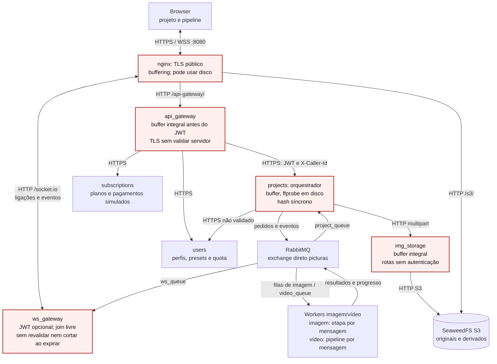
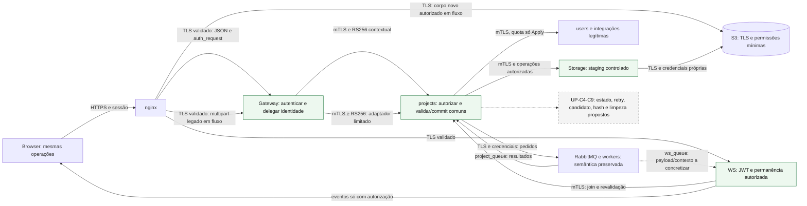

# Exercício 7 — Táticas arquiteturais para melhorar RNF do PictuRAS

> **Leitura na entrega (27/11/2026):** este documento preserva o diagnóstico/planeamento
> da data indicada. A implementação B0–B12 está concluída; estados «pendente» ou
> «por executar» no texto não descrevem o fecho da fase. Consultar o
> [relatório final](../../src-doc-fase2-template/README.md), os
> [resultados oficiais](../../README.md#resultados-oficiais) e as decisões posteriores no
> [handoff](../../refactor-handoff.md). O original é mantido para rastreabilidade.

### Fase 2 — Dos cenários às decisões e à avaliação

**Equipa:** PL2-G4.  
**Elementos:** PG64000 — Luís Miguel Coelho; PG65397 — Alexandre de Oliveira
Monsanto; PG63941 — Diogo Alexandre Gomes Silva; PG63522 — José Miguel da Silva Santos.  
**Commit de partida:** `484be13b4c8e96c70e7e694a2c368d5601749438`, igual ao Bloco 1;
base oficial `0523102`. **Checkout inicial consultado:** `1d7103b`; revisão sobre `405b6c0`, sem
alterações de aplicação no âmbito de EV-49.\
**Data da análise:** 2026-11-18; revisão documental em 2026-11-20; vista antes revista em 2026-11-23, Europe/Lisbon. **Versão deste documento:** 1.2.\
**Versões usadas:** enunciado 3.0 e template 3.0, de 2026-11-17.  
**Entradas:** Bloco 1, resolução 1.3; Bloco 2, resolução 1.1 baseada no material 1.1.

O catálogo de EV/H e ALT é o da [secção 2.6 do Bloco 1](../06-architectural-patterns/resolution.md).
Os cenários só se caracterizam no [Bloco 2, §4.2](../06-architectural-patterns/resolution-block-2.md#42-cenários-de-qualidade-para-a-extensão-de-vídeo).
DA-1/DA-2 aqui são IDs **deste exercício**, não substituem D1–D11, as escolhas WS/
PKI/UP/EVAL ou DA-01–DA-10 do PDF histórico PL1-G4. A cadeia de rastreabilidade é
CAND → QS → TAT → DA → elementos → observação BF/MF. (EV-38–EV-40, EV-44, EV-49)

**Estado:** é uma síntese académica das escolhas já registadas e das alternativas,
não aprovação adicional, código alterado ou melhoria demonstrada. UP-C4–C9 e
detalhes de realização mantêm-se abertos; a pausa na discussão dessas escolhas
não é revogada por resolver este exercício. BF/MF, calibração e revisão pela
equipa continuam pendentes. A data de 27/11 é a correção de planeamento do
utilizador, distinta do 20/11 nos originais. (EV-44, EV-45)

## 1. Cenários de entrada — do Bloco 2

### 1.1 Candidatos e cenários

Os campos de estímulo e resposta/medida abaixo são copiados literalmente da
definição canónica, não uma segunda versão do cenário. Fonte, artefacto e ambiente
continuam no Bloco 2; a carga/ambiente de medição é concretizada em §5.3.
QS-07 é complemento da mesma CAND-1 para revogação; não se caracteriza novamente
aqui nem cria uma terceira entrada principal.
(EV-38, EV-39)

| Candidato | Cenário | Característica / subcaracterística | Evidência / hipótese | Origem | Estímulo a que a tática reage — transcrito | Resposta e medida — transcritas | Escala e método |
|-----------|---------|----------------------------------|----------------------|--------|-------------------------------------------|--------------------------------|-----------------|
| CAND-1 | QS-01 | Segurança — confidencialidade, integridade e autenticidade | EV-24/EV-43; H-14 | Padrão global, herdado pelas operações de vídeo | Apresentar um pedido de acesso/operação sobre recurso de projeto sem autorização efetiva, incluindo entrada numa sala de projeto | Verificar identidade e autorização, recusar o acesso/efeito/entrada indevidos e preservar a operação legítima do controlo — Por caso: tentativas, admissões e efeitos de domínio/bytes/eventos verificados, fração de efeitos indevidos sobre tentativas e sucessos legítimos sobre controlos; recusas de rede/TLS/domínio e erros internos separados, sem contar 500/timeout como proteção. EV-24/EV-43; H-14 | Bloco 2 §5.1; mesmo cenário e método, concretizado em §5.3 |
| CAND-2 | QS-02 | Eficiência de desempenho — utilização de recursos; comportamento temporal como guarda | EV-08/EV-11/EV-42; H-15/H-17/H-18 | Interação entrada global/tamanho do vídeo | Enviar um vídeo válido de tamanho crescente, isolado ou com outros uploads | Aceitar e disponibilizar apenas o ficheiro validado/associado corretamente, limitando recursos e mantendo pedidos leves utilizáveis — Por serviço/janela: RSS absoluto/adicional/retido, memória cgroup/agregada, CPU/rede/disco, OOM/reinícios; t_ready−t_send, t_ready−t0, t_hash e cleanup; SHA-256 do original e respostas corretas, coexistência pareada. EV-08/EV-11/EV-42; H-15/H-17/H-18 | Bloco 2 §5.1; mesmo cenário e método, concretizado em §5.3 |

### 1.2 Alterações feitas ao Bloco 2

| Cenário | O que mudou e porquê | Onde foi atualizado |
|---------|---------------------|--------------------|
| QS-01 → QS-01 + QS-07 complementar | Revisão 1.1 em 20/11 separa tentativa de acesso de revogação de uma autorização existente, porque têm fontes/estímulos/relógios distintos. QS-01 mantém o ID para admissão; QS-07 é novo ID, sem reutilizar qualquer eliminado. CAND-1 permanece a mesma | Bloco 2 §4.2/§5.1, priorização e âmbito de CAND-1; campos de QS-01 retranscritos literalmente na §1.1 e TAT-04 referencia o complemento |
| QS-02 | Texto canónico inalterado; não se altera o cenário para o adequar à tática escolhida | Bloco 2 §4.2 e cópia literal na §1.1 |

**Quantificação:** baseline formal NM e valores finais a consolidar depois de
BF, conforme os materiais. Os critérios individuais de planeamento anteriores
ficam nas [métricas](../../fase2-metricas-e-baseline.md) e na
[revisão EVAL](../../fase2-revisao-plano-avaliacao.md), sem serem convertidos em
resultados ou aprovação de todos os 60 limiares. (EV-38, EV-39, EV-45)

## 2. Táticas candidatas

O Anexo A do enunciado 3.0 é a fonte do vocabulário de categorias. Uma tática é
a decisão que influencia a resposta; mTLS, nginx/S3 e o adaptador são meios de
a realizar, não nomes de atributos ou padrões que provem qualidade. **A:** muda
qualidade/estrutura mantendo capacidade; **B:** alteração visível que é objeto
da melhoria; **C:** capacidade nova, rejeitada para esta entrega. (EV-39, EV-47)

| ID | Cenário / candidato | Atributo → categoria | Tática | Estímulo → mecanismo → resposta esperada | Existe na base? | Classe |
|----|---------------------|----------------------|--------|----------------------------------------|-----------------|--------|
| TAT-01 | QS-01 / CAND-1 | Segurança → resistir | Identificar/autenticar atores em cada fronteira | Pedido de peer/cliente → verificar perfil de identidade e peer autorizado → rejeitar impersonação em vez de confiar num header | Parcial: JWT no gateway; caller interno decodifica e header é confiado; mTLS proposto ainda não existe. EV-08/EV-24/EV-46; H-14 | A |
| TAT-02 | QS-01 / CAND-1 | Segurança → resistir | Autorizar atores/operações no domínio | Leitura/mutação/join → projects decide posse/contexto/read/edit → só efeito/receção permitidos | Parcial: partilha/versionamento existem, sem matriz transversal e autorização de sala prevista. EV-24/EV-37/EV-46; H-14 | B na correção owner-only da eliminação; A no núcleo interno |
| TAT-03 | QS-01 / CAND-1 | Segurança → resistir | Limitar acesso/exposição e cifrar comunicação com validação | Caminho direto/certificado indevido → TLS/mTLS, credenciais próprias e identidade/operação específicas → reduzir superfície e confiança indevida | Parcial: HTTPS/portas e cifra de campos existem; não há validação completa do servidor/peer nem a gestão de chaves prevista nas decisões implementada. EV-07/EV-09/EV-24; H-14 | A |
| TAT-04 | QS-01, complemento QS-07 / CAND-1 | Segurança → reagir | Revogar acesso e limitar autorização local | Permissão/JWT deixa de valer → consulta por entrada e revalidação/corte da sala afetada → não manter receção indevida | Parcial: links revogados no HTTP; permanência WS não segue contrato. EV-22/EV-37/EV-44/EV-46; H-14/H-18 | A no mecanismo, B nos erros/reconexão visíveis necessários à melhoria |
| TAT-05 | QS-01 / CAND-1 | Segurança → resistir | Limitar exposição apenas no perímetro | Pedido externo → filtro da fachada/rede → bloquear parte das entradas | Parcial: checkToken já existe, mas acessos internos e efeitos verificados mostram cobertura insuficiente. EV-08/EV-24/EV-43 | A; alternativa insuficiente para o cenário completo |
| TAT-06 | QS-01 / CAND-1 | Segurança → resistir | Autorizar entrada WS por credencial de sala localmente verificada | Join → bilhete assinado/contextual → verificação local sem consulta por entrada | Não; era alternativa D6.2 A, substituída pela consulta B. Continua a exigir revogação/invalidação/permanência. EV-44; H-14 | A; não selecionada |
| TAT-07 | QS-01 / CAND-1 | Segurança → resistir | Separar entidades através de nova biblioteca/pastas privadas no produto | Utilizador organiza vídeos em capacidade nova → dados separados pela nova interface | Não; a biblioteca do requisito histórico não está implementada. EV-04/EV-10/EV-23 | **C — rejeitada**; separar internamente permissões não exige criar biblioteca |
| TAT-08 | QS-02 / CAND-2 | Desempenho → controlar procura | Reduzir a sobrecarga do transporte do corpo, separando-o do controlo | Corpo grande → nginx encaminha bytes autorizados para S3, Node mantém controlo → menor buffer/cópia nos Node | Não no percurso novo; corpo hoje passa pelos três Node. EV-08/EV-11/EV-12/EV-42; H-15 | A |
| TAT-09 | QS-02 / CAND-2 | Desempenho → controlar procura/gerir recursos | Aumentar eficiência por streaming/contrapressão e temporários limitados | Produtor rápido/ficheiro grande → consumo limitado e backpressure → não acumular corpo integral em RAM | Parcial: S3/worker têm processamento incremental, mas multer usa memória no upload. EV-11/EV-12/EV-17/EV-46; H-15 | A; obrigatória também no adaptador selecionado |
| TAT-10 | QS-02 / CAND-2 | Desempenho → gerir recursos | Escalonar cálculo do hash depois de ready, com estado/cache coerentes | Validação concluída → adiar leitura integral e controlar execução → reduzir caminho até ready sem fingir reduzir custo total | Não: hash atual é síncrono e required. Mecanismo UP-C7 ainda por selecionar. EV-12/EV-26/EV-44; H-16 | A se só interno e sem alterar conteúdo; candidata pendente |
| TAT-11 | QS-02 / CAND-2 | Desempenho → gerir recursos | Aumentar recursos sem alterar buffering | Upload → mais RAM disponível → adiar OOM | O Compose original não fixa limites de RAM; esta estratégia não elimina a dependência do tamanho observada. EV-09/EV-42 | A, mas não escolhida como solução principal; não provar melhoria mudando só budget final |
| TAT-12 | QS-02 / CAND-2 | Desempenho → gerir recursos | Limitar filas e arbitrar recursos de upload/validação/hash | Concorrência → admissão/filas finitas → limitar estado e espera, recusando excesso | Parcial noutros percursos, sem os limites propostos de upload implementados; UP-C5/C7 continuam abertos. EV-16/EV-44/EV-45; H-17 | A; números/mecanismo não escolhidos aqui |
| TAT-13 | QS-02 / CAND-2 | Usabilidade/desempenho → iniciativa do utilizador | Adicionar pausa/retoma por partes como capacidade visível | Interrupção → guardar partes e permitir retoma na interface → nova operação de utilizador | Não na base nem na seleção UP-C1/C2/C3; é evolução distinta, não requisito para corrigir RAM. EV-23/EV-44 | **C — rejeitada para este exercício/entrega**; não fecha a opção de protocolo UP-C4 por omissão |

O enquadramento A/B/C é análise da resolução, sujeita à revisão académica; não
transforma uma funcionalidade C em A por estar implementada num serviço interno.
Um journal operacional para preservação/reconciliação é diferente de um novo
audit trail consultável pelo utilizador. (EV-39; H-17)

## 3. Decisões arquiteturais

### DA-1 — Verificar confiança e autorização em cada fronteira (QS-01; QS-07 complementar)

| Campo | Conteúdo |
|-------|----------|
| Contexto | CAND-1/QS-01: portas/headers/TLS e WS permitem contornar verificações; efeitos conhecidos em EV-43. Preservar edição, partilha, imagem/vídeo, quota e billing, sem tratar a presença de serviços como prova de proteção. EV-24/EV-43; H-14 |
| Táticas escolhidas | TAT-01 + TAT-02 + TAT-03 + TAT-04, como síntese das decisões existentes D3/D4/D6/D7 e ACL; não nova aprovação da equipa. Cadeia: EV-24/EV-43 → CAND-1 → QS-01/QS-07 → TAT-01–04 → DA-1 → S01–S21/guardas → BF/MF. EV-44 |
| Estrutura/padrão realizador | Gateway como fachada e projetos como autoridade de domínio; mTLS nas APIs internas com autorização de serviço/operação; TLS validado/credenciais mínimas nos restantes canais. JWT HS256 utilizador e RS256 contextual interno têm funções distintas. WS consulta projects por join/revalidação; PKI local/retirada de confiança conforme contratos selecionados |
| Alternativas consideradas/rejeitadas | **TAT-05 isolada:** menor intervenção, mas gateway/loopback não impedem impersonação/ação indevida do peer interno. **TAT-06:** pode retirar consultas do caminho de entrada, mas acrescenta emissão/validade/invalidação de credenciais de sala; a consulta atual foi escolhida em D6.2 B, sem necessidade medida de bilhetes. **TAT-07:** rejeitada C, pois biblioteca nova não é refactoring desta fragilidade. EV-24/EV-43/EV-44; H-14 |
| Consequências positivas esperadas | Cobrir pedidos diretos, identificar peer/contexto, autorizar operação e retirar receção quando a permissão cessar. São previsões H-14/H-18, não resultados. EV-44 |
| Consequências negativas/riscos | Mais configuração, certificados/chaves e consultas; novos joins indisponíveis em falha, intervenção na renovação de sessões anónimas, custo de revogação/isolamento e risco de recusar caller legítimo. Claims curtas não dão exactly-once nem uso único; cópias de JWT têm residual registado. Prova anónima real continua desconhecida. EV-44/EV-45; H-14/H-17/H-18 |
| Elementos afetados | nginx, apiGateway/auth/rotas, wsGateway, projects/caller/middleware/rotas, users, subscriptions, imageStorageService, clientes Mongo/S3/broker, Tools/expand_ai e generative-mock, Compose/PKI/segredos e frontend de sessão/reconexão. É cobertura por canal, não só trocar um algoritmo |
| Origem/âmbito e risco | Global/interação: vídeo herda as mesmas APIs, dados, quota e eventos. Não muda efeitos nem formato de vídeo; alto risco de regressão nas operações legítimas. Testar imagem, vídeo, mistos e duas vias de acesso. EV-09/EV-14/EV-21/EV-44 |
| Classe | **B no conjunto; núcleo interno A.** Corrigir owner-only para eliminar projeto e explicitar corte/reconexão muda comportamento visível como objeto da segurança, sem criar nova capacidade de edição. A restrição DELETE não é regra herdada inequívoca; está explicitamente escolhida e precisa de justificação/teste. O editor continua a remover media. A seleção individual não é aprovação académica de preservação funcional: a equipa deve justificar a restrição como objeto da melhoria, sem a tratar como comportamento herdado ou concordância da docência. EV-39/EV-44 |

### DA-2 — Separar controlo de bytes e limitar recursos mantendo o contrato (QS-02)

| Campo | Conteúdo |
|-------|----------|
| Contexto | CAND-2/QS-02: buffers integrais e validação/hash provocam picos/retenção e pós-envio elevado em alguns pilotos. Preservar limites/perfis, conteúdo, nome/versão, edição/preview/export e quota. EV-08/EV-11/EV-42; H-15 |
| Táticas escolhidas | **Núcleo TAT-08 + TAT-09**, conforme preferência nginx/S3 e UP-C1 A, com UP-C2 A e UP-C3 A como condições: adaptador seguro, quota só Apply e pending isolado. TAT-10/TAT-12 são candidatas de realização ainda condicionadas a UP-C4–C9; não recebem seleção implícita. Cadeia: EV-08/EV-11/EV-42 → CAND-2 → QS-02 → TAT-08/09 → DA-2 → U01–U26/guardas → BF/MF |
| Estrutura/padrão realizador | Proxy de dados nginx/S3 com controlo autenticado separado; fachada/adaptador para o POST multipart, usando streaming e spool limitado quando necessário; regras/validação/autorização final/commit comuns. Coleção de tentativas e staging controlados até media válido. O estado concreto/candidato/limpeza ainda é desenho, não transação distribuída existente. EV-44 |
| Alternativas consideradas/rejeitadas | **TAT-11 isolada:** pode adiar OOM, mas não resolve custo proporcional aos bytes e viola a comparação se só MF ganhar RAM. **TAT-09 como percurso primário único por todos os Node:** é alternativa válida e mais conservadora para API, mas mantém bytes em todos os saltos; a escolha comunicada privilegia nginx/S3 com adaptador de compatibilidade, sem afirmar superioridade medida. **TAT-10 síncrona vs posterior:** mecanismo/prazo de realização ainda por fechar, não rejeitado por decreto. **TAT-13:** C, capacidade nova não necessária. EV-42/EV-44; H-15–H-17 |
| Consequências positivas esperadas | Menos buffers nos serviços Node e autenticação antes do corpo também no legado; compatibilidade HTTP preservada; tentativa inválida não entra nos media normais. São H-15/H-17/H-18, por medir |
| Consequências negativas/riscos | Dois transportes, mais estados e caminhos de falha; staging/cópias/hash podem aumentar disco/rede/tempo e complexidade. Backpressure/temporários precisam de limites reais; 2xx ao PUT não é ready nem commit. Uma coleção separada não garante isolamento/idempotência. Manter ambos os percursos exige testes de recursos e não manter bypass em memória. EV-44; H-15–H-18 |
| Elementos afetados | frontend/lib/projects.ts e tratamento de upload; nginx; apiGateway/routes/projects.js; projects/rotas/modelos/validação/storage/cache; imageStorageService; Compose/credenciais. Worker de vídeo, fila e semântica dos efeitos mantidos; guardas de regressão atravessam imagem/vídeo |
| Origem/âmbito e risco | Interação: transporte global mais volume do vídeo, não granularidade dos efeitos. Não escolhe ALT-1/ALT-2. Alto risco de orphan/associação/versionamento, cache sem hash e discrepância entre adaptador e fluxo novo. Provar resource-use sem esconder trabalho posterior. EV-12/EV-26/EV-42/EV-44 |
| Classe | **A no núcleo:** mesma capacidade de carregar e editar, mantendo POST multipart/204/X-Project-Version, limites/perfis e quota. Novo protocolo interno não é pausa/retoma ou biblioteca; não acrescentar essas capacidades. Uma eventual interação visível adicional precisa de justificação B própria, sem assumir aprovação. EV-39/EV-44 |

## 4. Vista arquitetural — antes e depois

### Antes — realização de aplicação observada

[Fonte editável](diagrams/before.mmd), [configuração de renderização](diagrams/before-render.json)
e [revisão de 23/11](evidence/before-view-review-2026-11-23.md). A vista representa
a base `0523102`, não o desenho mTLS nem um bloco já implementado. O layout vertical
permite ler a imagem no relatório. Vermelho assinala fragilidades dos percursos
mostrados; não significa que cada pedido falha.

O upload multipart passa integralmente pelos três Node; no gateway o buffer é
preenchido antes de verificar o JWT. O nginx pode usar temporários, e a projects
cria um temporário para o ffprobe e calcula o hash antes da resposta. HTTPS interno
sem validar servidor continua cifrado, mas não verifica o certificado remoto.
O acesso público aos objetos usa `/s3/` pelo nginx, separado do upload via API.

O RabbitMQ e os workers são componentes distintos. A projects publica pedidos nas
filas das ferramentas/`video_queue` e eventos em `ws_queue`; os workers respondem
em `project_queue`, e o worker de vídeo também publica progresso em `ws_queue`.
Só `project_queue` alimenta o orquestrador; `ws_queue` alimenta o WS. Ligações e
eventos Socket.IO atravessam o nginx nos dois sentidos. Não existe consulta
WS → projects, autenticação mTLS ou revalidação de salas nesta base.

É uma vista parcial: frontend, MongoDB/backup, volumes e canais IA não estão
representados; ver a [vista global do Bloco 1](../06-architectural-patterns/diagrams/arquitetura_global_plantuml.svg).
EV-07–EV-12/EV-22/EV-24/EV-40/EV-46/EV-49.

### Depois — desenho selecionado, ainda não implementado

[Fonte editável](diagrams/after.mmd). Verde: realizações das táticas escolhidas,
**previstas**, não em execução; cinzento/tracejado: mecanismos não selecionados.
TAT-01–04 estão nas fronteiras/WS; TAT-08/09 no percurso de bytes/adaptador.
Certificados/identidade não substituem autorização de operação ou objeto. S3
não é a API mTLS de domínio: usa o TLS/credenciais escolhido para esse canal.
O payload/contexto dos eventos tem de ser adequado para autorizar emissões em
salas pessoais e de projeto; o tracejado não demonstra esse mecanismo pronto.
As cópias/candidato/hash e callbacks de transporte não são omitidos da medição
só por aparecerem resumidos na vista. EV-44/EV-45; H-14–H-18.

## 5. Trade-offs e plano de medição

### 5.1 Matriz de efeitos

Setas descrevem **hipóteses de efeito**, não ganhos provados. ↑ favorável ao
atributo, ↓ risco de degradação do atributo, = sem mudança direta;
as setas não indicam o sinal numérico de RSS/tempo. Por exemplo, baixar RSS
pode melhorar utilização de recursos, sem provar menor latência. As combinações
indicam trade-off que exige medição. Não se somam setas nem se cria ranking quantitativo. (H-14–H-18)

| Decisão | Desempenho | Disponibilidade / fiabilidade | Segurança | Usabilidade | Manutenibilidade / testabilidade | Justificação |
|---------|------------|--------------------------------|-----------|-------------|----------------------------------|--------------|
| DA-1 | ↓ possível pelo overhead de identidade/TLS/consultas | ↓ novas entradas em falha/rotação; integridade de acesso ↑ | ↑ esperado | = capacidade; ↓ intervenção/reconexão se mal tratada | ↓ gestão de trust/pares; ↑ contratos/probes verificáveis | TLS/queries/leases têm custo; não autorizar em falha protege o domínio, mas reduz disponibilidade. Controlos positivos impedem «melhorar» segurança desligando operações. EV-44; H-14/H-17/H-18 |
| DA-2 | ↑ esperado em eficiência de memória; ↓ possível no comportamento temporal por I/O adicional | ↑ esperado por menor pressão; ↓ se estados/cópias não forem reconciliados | ↑ esperado por auth antes do corpo; ↓ se o isolamento pending/capacidades S3 falhar | = capacidade; ↑ aceitação esperada, ↓ erros mal explicados | ↓ dois transportes/estados; ↑ domínio/commit comuns e probes | Deslocar bytes/cálculo não os elimina; adaptar com limites pode preservar API, mas exige validar ambos os percursos e as guardas. EV-42/EV-44; H-15–H-18 |

### 5.2 Interação entre DA-1 e DA-2

| A | B | Efeito | Razão / evidência |
|---|---|--------|-------------------|
| DA-1 | DA-2 | Pré-requisito | Autorização de emissão/transporte/objeto e identidade confiável impedem que o novo S3 contorne a política ou consuma corpo antes do controlo. EV-44; H-14/H-15 |
| DA-2 | DA-1 | Sinergia | Streaming e admissão antes do corpo podem reduzir recursos de pedidos indevidos; não substituem autenticação do peer. H-15/H-18 |
| DA-1 | DA-2 | Conflito | TLS/assinatura/queries podem degradar latência/CPU enquanto DA-2 procura reduzir recursos; U25 G e tempos equivalentes têm de passar por avaliação. EV-45; H-18 |
| DA-2 | DA-1 | Dependência de consistência | Domínio escolhe quando um media passa a ser utilizável; hash/cache/limpeza incorretos podem violar isolamento apesar de TLS válido. EV-44; H-16 |

### 5.3 Plano de medição — concretização do esboço do Bloco 2

| Cenário | Teste/carga | Ambiente | O que registar | Repetições/agregação | Scripts/dados |
|---------|-------------|----------|---------------|----------------------|---------------|
| QS-01 e complemento QS-07 | Matriz pública/host/peer Docker com dono/editor/leitor/outro, rotas users/subscriptions/storage, TLS por canal; join/revogação/falha/expiração WS. N1=50, J1=510, P1=200; L1/L2 testam recusa de 513/4097, não suporte integral | Esta máquina/Luís; projeto experimental/configuração/corpus ainda por congelar; serviços de cada caso presentes. Mesmo cenário físico/cliente antes/depois; baseline sem mecanismos novos mede o efeito equivalente | Tentativas e controlos positivos, estado/bytes/eventos, timings, falhas de rede/TLS/domínio separadas, fila/CPU/RSS/latência e alcance efetivo; sem segredos | Plano selecionado: três repetições por caso materializado e janelas WS de 30 s; raw/mediana/máximo sem p95 de três amostras. Preparação, admissão e janela distinguidas | [Probes históricos auditados](../../../memory-bank/intents/001-phase-2-quality-improvements/evidence/nfr-2026-11-16/README.md), [métricas](../../fase2-metricas-e-baseline.md), [contrato WS](../../architecture/fase2-sessoes-identidade-partilhas-ws.md). Instrumentos novos ainda não existem |
| QS-02 | Plano EVAL selecionado: 100 normais (perfis/tamanhos/H-T/estados), nove C=3, coexistência separada com três uploads/600 pedidos leves; formatos/fronteiras e ambos os transportes materializados. 1024 MiB/+1 byte só guarda funcional separada | Mesmo host e budgets por fase; 10 GiB agregado e piso ≥60 GiB são condições a calibrar, não prontidão. Não usar volumes retidos. Imagens/dependências/gerador/controle fixados e corpo do gerador em fluxo | RSS absoluto/incremento/retido, cgroup e pico simultâneo, CPU/rede/disco/temporários, t0/t_send/t_ready/t_hash/t_cleanup, integridade, nomes/versão/quota, OOM/erros e pedidos leves | Cinco tentativas por estrato, três rodadas C=3 e três pares de coexistência; conservar falhas e denominador. Memória do grupo não é dividida por três. U25 compara com/sem carga na mesma campanha | [Plano/revisão](../../fase2-plano-avaliacao.md), [manifesto](../../templates/phase2-evaluation-manifest.template.json), [modelo resultado](../../templates/phase2-evaluation-result.template.json), scripts históricos para adaptar; corpus gerado fora do Git |

**Gates:** medir BF antes do refactoring; condições/método/corpus congelados,
depois MF equivalente. Mecanismo novo NA exige conformidade separada e comparação
do efeito funcional equivalente, nunca baseline zero inventada. OOM/timeout com
instrumento/ambiente corretos é resultado da base; serviço ausente/asserção errada
é inconclusivo, não proteção. Novas condições obrigatórias implicam revisão e
repetição comparável, sem ocultar a fragilidade por dar RAM só ao final.
(EV-38/EV-39/EV-42/EV-43/EV-45)

Para o relatório usar `baseline / mínimo / meta / final / diferença / conclusão /
limitação / bruto`, por estrato. Valores finais aguardam BF; critérios EVAL já
selecionados ficam identificados como condições de planeamento e não se apagam.
Só afirmar cumprimento temporal se a incerteza/limite superior o permitir.
U11/U12 são D, U25 é G; EVAL-M1 não aprova por omissão todos os 60 limiares.
(EV-45)

### 5.4 Preservação funcional

| Zona | Regressões existentes | Lacunas | Provas a acrescentar, ainda não executadas |
|------|-----------------------|---------|-------------------------------------------|
| DA-1: confiança/API/ACL | `projects/tests/video-pipeline.test.js`, `process-batch.test.js`, `frame-extraction.test.js` cobrem regras/commit de processamento | Não são testes end-to-end de mTLS/JWT/owner/serviço/billing/rotas legítimas | Matriz por canal/par/operação com positivo e negativo, projeto/media dono/editor/leitor, revogação/duas vias e limpeza autorizada da conta |
| DA-1: WS/sessões | Testes de vídeo cobrem produtor/progresso em escopo limitado, não política de sala | Falta autorização de room/expiração/permanência, eventos pessoais, reconexão e importação que suspenda bootstrap | WS-T/AR e cenários v1; preservar mesmo ID/projetos, negar sem prova real e testar importação só com fixtures independentes conhecidas |
| DA-2: HTTP/upload/storage | Suites do orquestrador/worker validam semântica a jusante | Não provam buffers limitados, estados de upload, rollback S3/DB, hash assíncrono ou compatibilidade HTTP | Novo/legado válidos/negativos, saldo zero sem cobrança, duplicação de confirmação/409, pending invisível, falhas e RSS até cleanup; UL-01–12 continuam planos |
| DA-2: pipeline/resultados | `test_video_processor.py` e `test_frame_extraction.py`; testes Node de vídeo/extracção | Falta combinação real com transportes/PKI novos, cargas e imagens mistas | Pixels/ordem/áudio/trim-speed/export, original SHA-256 inalterado e resultados sem exigir igualdade binária com fonte transformada |
| Ambos: legendas/IA | `test_subtitles.py` usa recognizer simulado, FFmpeg real; no-op e regras já testáveis | Simulação não avalia Whisper real nem mTLS expand_ai→mock e restantes consumidores | Fala real curta/sem fala e no-op, modelos identificados; fluxo legítimo/negativo de cada canal IA/mock/broker selecionado |
| Ambos: implantação/recuperação | EV-28/EV-41 preservam ensaios históricos, não ensaios novos | PKI/isolamento/reconciliação e atualização de dados ainda sem implementação/prova | Renovação/retirada/retomas/consumidores, scripts administrativos e falhas; ambas as instalações retidas preservadas; sem declarar retoma automática por reiniciar consumidores |

EV-27/EV-28 registam testes anteriores; EV-46 é releitura de código. **Nenhum
teste foi executado para produzir esta resolução.** As 12 verificações UL são
cenários futuros, não uma suite existente nem resultados aprovados.

## 6. Utilização de IA

| Ferramenta/modelo | Tarefa apoiada | Conteúdo incorporado na resolução | O que foi rejeitado e porquê | Como foi validado / estado humano |
|------------------|----------------|----------------------------------|-----------------------------|----------------------------------|
| Codex; contexto da skill specsmd-inception-agent previamente usada | Ler enunciados/templates, código/decisões/pilotos; sintetizar táticas/DA e vistas | Rastreabilidade e distinção entre base, decisões individuais e hipóteses; versões 1.1/3.0 e uso literal dos cenários | Confundir mTLS com autorização, retirar legado, cobrar upload, escolher UP-C4–C9 por preencher a ficha ou prometer ganhos sem BF | Confronto estático com código/fontes e histórico; utilizador comunicou escolhas anteriores, mas a equipa ainda deve rever esta resolução |
| Codex com verificações documentais locais | Organizar fontes com hash, comparar aplicação, conferir IDs/cópias/caminhos/Mermaid editável | Material original intacto, referências explícitas e revisão de cenários/matriz/filas em EV-49 | Inventar testes, fontes letivas ausentes, medidas finais ou livro consultado sem conteúdo | Registo de verificação; validação automática não é revisão nominal da equipa nem teste de arquitetura em runtime |

### Lista de verificação antes da entrega

- [x] CAND-1/QS-01 e CAND-2/QS-02 reutilizados do Bloco 2, sem redefinir cenários.
- [x] Pelo menos três táticas por cenário, categorias/existência/EV/H/classes A/B/C.
- [x] Duas DA com duas ou mais alternativas, consequências e elementos afetados.
- [x] Vistas antes/depois em Mermaid com legenda e fonte editável; depois é desenho.
- [x] Matriz com cinco atributos, interação, método BF/MF e regressões/lacunas.
- [x] IA registada; factos e previsões distinguidos; valores não inventados.
- [x] Versões 3.0 usadas; não se reintroduz a revisão cruzada removida do enunciado.
- [ ] Revisão académica pela equipa; quantificação final, implementação e avaliação.

O [registo da revisão](evidence/verification-2026-11-20.md) separa as correções
documentais de ensaios e validação humana. O [índice](README.md) identifica as
fontes presentes e as folhas/slides de apoio não fornecidos. Usou-se o Anexo A do HTML; não se afirma leitura integral de SAIP
ou de PDFs ausentes. EV-39/EV-47/EV-48.
